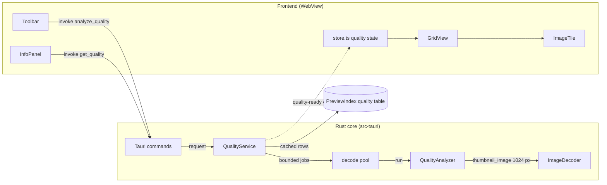
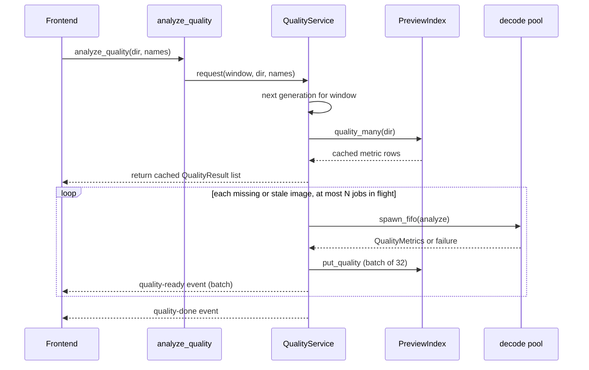
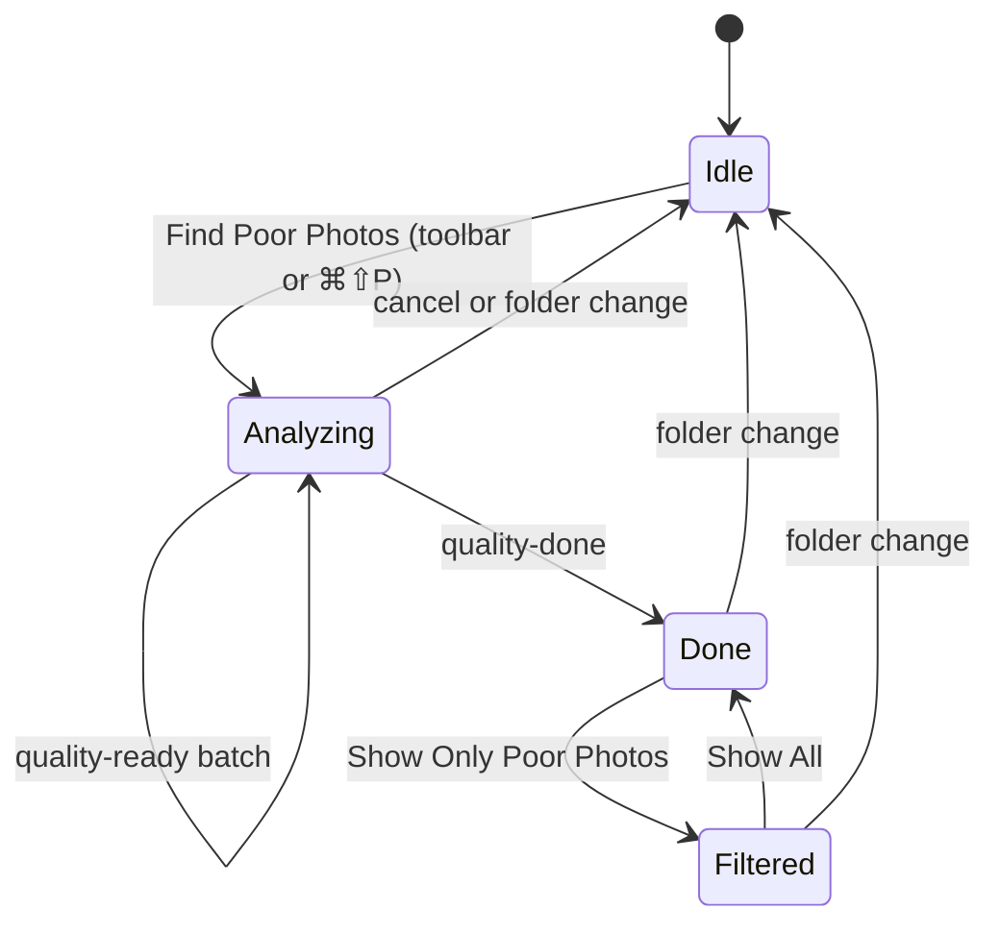

# Photo Quality Detection

## Summary

Photo quality detection finds poor photos in the open folder: blurry, underexposed, and overexposed images. The user
reviews the flagged images and moves them to the Trash in edit mode (EDIT-01 to EDIT-07).

Phase 1 uses only deterministic algorithms, with no machine learning model and no new dependency. The algorithms are
Laplacian variance, the Tenengrad gradient, the Brenner gradient, and a luminance histogram.

The analysis runs only on request, so it does not affect the performance budgets PERF-02 to PERF-10 (PRIO-01, PRIO-02).

> Rationale: a full scan of a 10,000-image folder costs a full image decode for each file. That is far more work than
> thumbnail generation, and it competes for the same decode threads. An automatic scan on folder open would break
> PERF-06 and PERF-07 while it runs. On-demand analysis keeps the cost under user control.

The keywords `MUST`, `MUST NOT`, `SHOULD`, and `MAY` have the meaning from RFC 2119.

## Context and Gap

| Existing                                     | State today                                                       | Change                                                         |
|----------------------------------------------|-------------------------------------------------------------------|----------------------------------------------------------------|
| `decode::thumbnail_image` (`src-tauri/src/decode/mod.rs`) | Decodes an oriented `CGImage` with a maximum long edge, through ImageIO subsampling | `QualityAnalyzer` calls it with the analysis size              |
| `PreviewIndex` (`src-tauri/src/scan/index.rs`)            | SQLite tables `previews` and `taken`                              | New table `quality`                                            |
| `scan::fill_taken` (`src-tauri/src/scan/mod.rs`)          | Computes missing EXIF dates in parallel and caches them by `mtime` | Reference pattern for the cache lookup of quality results      |
| `FolderPreviewService` (`src-tauri/src/scan/preview.rs`)  | Cancels old jobs with a generation counter per window, emits events | Reference pattern for job cancel and result events             |
| `pools::decode()` (`src-tauri/src/pools.rs`)              | Thread pool for decode, one thread per performance core (THM-12)   | Runs the analysis jobs, with a limit on jobs in flight         |
| `AppState` (`src-tauri/src/lib.rs`)                       | Holds the services                                                | New field `quality: Arc<QualityService>`                       |
| `ImageTile` (`src/components/Tile.tsx`)                   | Shows thumbnail and name                                          | Shows a quality badge                                          |
| `InfoPanel` (`src/components/InfoPanel.tsx`)              | Shows file and EXIF data                                          | Shows the metric values                                        |
| `Settings` (`src-tauri/src/commands/settings.rs`)         | No quality settings                                               | New thresholds and a sensitivity value                         |

## System View



```text
src-tauri/src/
├── quality/
│   ├── mod.rs        # QualityService: cache lookup, job feeder, cancel, events
│   ├── analyze.rs    # QualityAnalyzer: gray buffer, metrics, verdict
│   └── kernels.rs    # Laplacian, Sobel, Brenner, histogram (pure Rust, unit-tested)
├── scan/index.rs     # + quality table
└── commands/mod.rs   # + analyze_quality, cancel_quality, get_quality
src/
├── lib/api.ts        # + QualityResult types and command wrappers
├── lib/store.ts      # + quality store, filter state
└── components/       # Tile.tsx badge, InfoPanel.tsx rows, Toolbar.tsx button
```

## Algorithms

### The analyzer works on a normalized grayscale buffer

1. `QualityAnalyzer` decodes the image with `decode::thumbnail_image(path, ANALYSIS_EDGE)`.
2. It draws the `CGImage` into an 8-bit `CGBitmapContext` with a `DeviceGray` color space.
3. All metrics read this buffer of `u8` luminance values.

| Constant        | Value   | Purpose                                                    |
|-----------------|---------|------------------------------------------------------------|
| `ANALYSIS_EDGE` | 1024 px | Long edge of the analysis buffer                           |
| `TILE`          | 128 px  | Side of one tile for the local sharpness metric            |
| `ALGO_VERSION`  | 1       | Version of the metrics; a change makes cached rows invalid |

> Rationale: Laplacian variance and gradient metrics depend on the image scale. A downscale by 2 makes edges look
> sharper, so a blurry 48 MP photo and a blurry 12 MP photo give different values at full size. A fixed analysis size
> makes one threshold valid for all cameras. 1024 px keeps enough detail to see focus blur, and the JPEG path of
> `thumbnail_image` gets it from a 1/4 subsampled DCT decode, which is fast. The 512 px thumbnail from `ThumbCache` is
> rejected as input: the downscale hides moderate blur, and the JPEG compression at quality 80 adds block edges that
> raise the Laplacian response.

> Assumption: 1024 px is a good balance of speed and accuracy. Verify with the calibration tool (see Verification):
> compare the separation of sharp and blurry samples at 768, 1024, and 1536 px.

> Rationale for grayscale through CoreGraphics: `DeviceGray` drawing does the color conversion in optimized native
> code. A conversion in Rust from RGBA is also acceptable if the benchmark shows it is faster.

### The analyzer computes these metrics

| Metric field       | Algorithm                                                                                     | Meaning                         |
|--------------------|-----------------------------------------------------------------------------------------------|---------------------------------|
| `lap_var`          | Variance of the 3×3 Laplacian `[0 1 0; 1 -4 1; 0 1 0]` over all interior pixels              | Global sharpness                |
| `lap_var_local`    | 90th percentile of the per-tile Laplacian variances                                           | Sharpness of the sharpest areas |
| `tenengrad`        | Mean of `Gx² + Gy²` from the 3×3 Sobel operators                                              | Gradient sharpness              |
| `brenner`          | Mean of `(I(x+2, y) − I(x, y))²`                                                              | Cheap gradient sharpness        |
| `mean_luma`        | Mean of all luminance values, 0 to 255                                                        | Overall brightness              |
| `std_luma`         | Standard deviation of the luminance values                                                    | Global contrast                 |
| `clip_dark`        | Fraction of pixels with luminance ≤ 5                                                         | Crushed shadows                 |
| `clip_bright`      | Fraction of pixels with luminance ≥ 250                                                       | Blown highlights                |

- `kernels.rs` computes the Laplacian, the Sobel, the Brenner, and the histogram values in one pass over the buffer.
- `kernels.rs` uses integer arithmetic (`i32` per pixel, `i64` or `f64` sums) and no `unsafe` code.

> Rationale for the local metric: a portrait with a sharp subject and a blurred background (shallow depth of field)
> has a low global Laplacian variance. The global metric flags it as blurry, which is a false positive. The sharpest
> tiles describe the focus of the subject. The 90th percentile ignores 1 or 2 tiles with noise or a hard text edge.
> `lap_var_local` is the primary blur metric for this reason.

> Rationale for all 3 sharpness metrics: the request is to start with the algorithmic approach and compare. Phase 1
> stores all 3 so that the calibration tool can show which metric separates the user's sample set best. The verdict
> uses only `lap_var_local` until calibration shows a better choice.

> Source: Laplacian variance as a blur measure: Pech-Pacheco et al., "Diatom autofocusing in brightfield microscopy: a
> comparative study", ICPR 2000. Tenengrad and Brenner: Krotkov, "Focusing", IJCV 1987, and Brenner et al. 1976, as
> compared in Pertuz et al., "Analysis of focus measure operators for shape-from-focus", Pattern Recognition 2013.

### The analyzer assigns flags from the metrics

| Flag          | Condition                                              | Default threshold                         |
|---------------|--------------------------------------------------------|-------------------------------------------|
| `blurry`      | `lap_var_local < blur_threshold`                       | `blur_threshold` = 100                    |
| `underexposed`| `mean_luma < 50` and `clip_dark > 0.40`                | `dark_mean` = 50, `dark_clip` = 0.40      |
| `overexposed` | `mean_luma > 205` and `clip_bright > 0.25`             | `bright_mean` = 205, `bright_clip` = 0.25 |
| `low_contrast`| `std_luma < 20`                                        | `contrast_min` = 20                       |

- An image with 1 or more flags has the verdict `poor`. An image with no flags has the verdict `ok`.
- The user changes the sensitivity in Settings: `low`, `medium`, `high`. The sensitivity multiplies `blur_threshold`
  by 0.5, 1.0, or 2.0.
- `QualityService` applies the thresholds when it builds the result, not when it stores the metrics. A change of a
  threshold MUST NOT start a new analysis.

> Assumption: all default thresholds are guesses. The value 100 for Laplacian variance is the common value from OpenCV
> tutorials, for images of about 500 to 1000 px. The exposure values are first estimates. Calibrate each value on a set
> of real photos before release (see Verification), and update this table.

> Rationale for separate storage of metrics and flags: the thresholds will change during calibration and with the
> sensitivity setting. A stored metric stays valid; a stored verdict does not.

> Risk: a night photo, a snow scene, and a low-key studio photo are underexposed or overexposed by the histogram
> rules but are correct. The `mean_luma` and `clip_*` conditions together reduce these false positives. The badge shows
> the reason, and the user decides. The detector never acts on its own.

> Risk: sensor noise at high ISO raises the Laplacian variance, so a noisy blurry photo can pass as sharp. The
> downscale to 1024 px averages most of the noise. If calibration shows false negatives, add a 3×3 Gaussian blur
> before the Laplacian and record the change as `ALGO_VERSION` 2.

## Behavior

### `QualityService` analyzes the images of one folder



- `analyze_quality` returns the cached results at once and analyzes only images whose row is missing or stale.
- A row is stale when its `mtime`, its `size`, or its `algo_version` differs from the current value.
- The feeder keeps at most `perf_cores() / 2` analysis jobs in the decode pool, with a minimum of 1.
- A new `analyze_quality` call from the same window cancels the jobs of the previous call that did not start.
- `cancel_quality` cancels the jobs that did not start. A folder change in the window calls `cancel_quality`.
- `QualityService` emits `quality-ready` events in batches of up to 32 results or every 250 ms.
- `QualityService` emits `quality-progress` with `done` and `total` with each batch.
- An image that fails to decode gets the verdict `error`. The service stores no row for it.

> Rationale for the job limit: the decode pool takes jobs in FIFO order from its global queue. If the service sends
> 10,000 jobs at once, a new thumbnail request waits behind all of them, and the grid stops loading thumbnails
> (GRID-09, PERF-06). With at most `perf_cores() / 2` jobs in flight, a thumbnail job waits for at most 1 analysis
> job, and half of the threads stay free for thumbnails. A separate pool is rejected: it would exceed the thread limit
> of THM-12.

> Context: `FolderPreviewService` in `src-tauri/src/scan/preview.rs` uses the same generation counter per window to
> cancel old jobs. Reuse that pattern.

### The file system watcher keeps results valid

- `QualityService` does not listen to `FsWatcher`. The stale check by `mtime` and `size` detects a changed file at the
  next request.
- The frontend removes the quality result of each file that `fs-changed` reports.
- If the analysis is active for the folder, the frontend calls `analyze_quality` for these files.
- `clear_cache` in Settings also clears the `quality` table.

> Rationale: this is the same approach as the `taken` table, which also relies on the `mtime` check. It adds no work
> to the watcher thread.

### The user reviews poor photos



- The toolbar has a "Find Poor Photos" button. The status bar shows the progress, for example "Analyzing 340 / 2,000".
- Each image tile with the verdict `poor` shows a badge. The badge tooltip lists the flags, for example "Blurry,
  Underexposed".
- The filter "Show Only Poor Photos" hides the other images in the grid. The viewer uses the filtered list.
- In edit mode, the user moves the flagged images to the Trash with the existing actions (FILE-01, FILE-02, FILE-05).
- The information panel shows the metric values and the flags of the selected image.
- The app MUST NOT move or change a file because of a quality result.

> Rationale for the filter instead of a new sort key: a sort key changes `SortSpec`, which is part of the
> `PreviewIndex` key (FPV-04) and of the folder preferences. A sort by sharpness is listed in Future Improvements.

## Data Model

### SQLite table `quality` in `PreviewIndex`

| Column         | Type    | Purpose                                     |
|----------------|---------|---------------------------------------------|
| `dir`          | TEXT    | Folder path (primary key part 1)            |
| `name`         | TEXT    | File name (primary key part 2)              |
| `mtime`        | INTEGER | File modification time in ms, for the stale check |
| `size`         | INTEGER | File size in bytes, for the stale check     |
| `algo_version` | INTEGER | `ALGO_VERSION` at analysis time             |
| `data`         | TEXT    | `QualityMetrics` as JSON                    |

> Rationale: the `quality` table follows the layout of the `taken` table (`WITHOUT ROWID`, key `(dir, name)`). JSON in
> `data` lets the metric set change without a schema migration; `algo_version` marks old rows.

### Types

| Type             | Purpose                                                             | Defined in                          |
|------------------|---------------------------------------------------------------------|-------------------------------------|
| `QualityMetrics` | The 8 metric values of the metrics table                            | `src-tauri/src/quality/analyze.rs`  |
| `QualityFlag`    | `blurry`, `underexposed`, `overexposed`, `lowContrast`              | `src-tauri/src/quality/analyze.rs`  |
| `QualityResult`  | `name`, `verdict` (`ok`, `poor`, `error`), `flags`, `metrics`       | `src-tauri/src/quality/mod.rs`      |
| `QualitySettings`| `sensitivity` and the thresholds of the flags table                 | `src-tauri/src/commands/settings.rs`|
| `QualityResult` (TS) | Mirror of the Rust type                                         | `src/lib/api.ts`                    |

### Commands and events

| Name               | Kind    | Input                    | Output                                   |
|--------------------|---------|--------------------------|------------------------------------------|
| `analyze_quality`  | command | `dir`, `names: string[]` | Cached `QualityResult[]`                 |
| `cancel_quality`   | command | none (window from call)  | none                                     |
| `get_quality`      | command | `path`                   | `QualityResult` (analyzes if missing)    |
| `quality-ready`    | event   | none                     | `{ dir, results: QualityResult[] }`      |
| `quality-progress` | event   | none                     | `{ dir, done, total }`                   |
| `quality-done`     | event   | none                     | `{ dir }`                                |

- Each new command needs a permission file in `src-tauri/permissions/` and an entry in
  `src-tauri/capabilities/default.json` (SEC-02).

## Requirements

- [ ] **QUAL-01** The user MUST start the analysis of the open folder with a toolbar button and with `⌘⇧P`.
- [ ] **QUAL-02** The app MUST NOT start an analysis without a user request.
- [ ] **QUAL-03** `QualityAnalyzer` MUST compute the metrics on a grayscale buffer with a long edge of `ANALYSIS_EDGE`.
- [ ] **QUAL-04** `QualityAnalyzer` MUST use `lap_var_local` for the `blurry` flag.
- [ ] **QUAL-05** `QualityService` MUST store the metrics in the `quality` table and reuse rows that are not stale.
- [ ] **QUAL-06** `QualityService` MUST keep at most `perf_cores() / 2` analysis jobs in the decode pool.
- [ ] **QUAL-07** A folder change MUST cancel the analysis jobs that did not start.
- [ ] **QUAL-08** The grid MUST show a badge with the flags on each image with the verdict `poor`.
- [ ] **QUAL-09** The user MUST be able to show only the images with the verdict `poor`.
- [ ] **QUAL-10** The information panel MUST show the metric values and the flags.
- [ ] **QUAL-11** Settings MUST contain the sensitivity. A change MUST update the verdicts without a new analysis.
- [ ] **QUAL-12** The app MUST NOT change or move a file because of a quality result.
- [ ] **QUAL-13** PERF-06 and PERF-07 MUST pass while an analysis runs.
- [ ] **QUAL-14** The analysis of one 24 MP JPEG MUST take 40 ms or less on the reference machine.
- [ ] **QUAL-15** The implementation MUST NOT add a new crate dependency.

> Rationale for QUAL-14: PERF-07 allows 30 ms for a 256 px thumbnail. The analysis decodes at 1024 px, which costs
> more, and adds about 1 MP of kernel work. 40 ms gives about 25 images per second per thread, so a 2,000-image folder
> takes about 16 s with 5 threads on the M1 (4 performance cores, 2 analysis threads: about 40 s).

> Assumption: the 40 ms budget is an estimate from the PERF-07 result (17.6 ms on the M4 Pro). Measure it with the new
> benchmark row before the value is final.

> Rationale for QUAL-15: OpenCV gives the same metrics, but it adds tens of MB to the bundle (PERF-01 allows 15 MB) and
> a C++ build dependency. The kernels are about 150 lines of Rust.

## Verification

- [ ] Unit tests in `kernels.rs`: a flat image gives 0 for all sharpness metrics. A box-blurred checkerboard gives
  lower values than the original checkerboard.
- [ ] Unit tests in `analyze.rs`: a black image gets `underexposed`; a white image gets `overexposed`.
- [ ] Benchmark row in `src-tauri/benches/core.rs`: analysis of the generated 24 MP photo (QUAL-14). Record the result
  in `docs/benchmarks.md`.
- [ ] Calibration example `src-tauri/examples/quality_dump.rs`: prints the metrics of each image in a folder as CSV.
  Run it on a labelled set of 50 or more sharp and 50 or more blurry photos. Set `blur_threshold` from the result.
- [ ] Scripted run with `FG_DEV_SCRIPT`: open a 10,000-image folder, start the analysis, and scroll the grid. PERF-06
  and PERF-08 MUST pass (QUAL-13).

> Context: the `examples/example gallery/` folder has 6 photos. That set is too small for calibration. Use a personal
> photo library with images marked by hand, and add 2 or 3 small blurry and sharp samples to `examples/` for the unit
> tests.

## Tasks

- [ ] Add `quality/kernels.rs` with the metric functions and unit tests.
- [ ] Add `quality/analyze.rs`: gray buffer from `thumbnail_image`, `QualityMetrics`, flags.
- [ ] Add the `quality` table, `quality_many`, and `put_quality` to `PreviewIndex`. Clear it in `clear`.
- [ ] Add `QualityService` with the job feeder, the generation cancel, and the events. Add it to `AppState`.
- [ ] Add the commands, permissions, and capability entries.
- [ ] Add `QualitySettings` to `Settings` and to `SettingsView.tsx`.
- [ ] Add the frontend store, the toolbar button, and the shortcut.
- [ ] Add the badge, the filter, the status bar progress, and the information panel rows.
- [ ] Add the benchmark row and the calibration example. Calibrate the thresholds (see Assumption under the flags table).
- [ ] Add the QUAL requirements to `docs/requirements.md` after review of this document.

## Limitations

- The analysis finds focus blur and strong motion blur. It does not reliably find slight camera shake, because the
  downscale to 1024 px hides blur of 1 or 2 pixels at full size.
- The metrics do not judge composition, closed eyes, or aesthetic value. These need machine learning (see Future
  Improvements).
- A photo with intentional blur, for example a long exposure or a panning shot, gets the `blurry` flag.
- RAW files use the embedded preview through `thumbnail_image`. The result describes the camera JPEG rendering.

## Open Questions

1. Analysis scope: only the open folder, or the folder tree?
   - **Open folder only (recommended, assumed by this spec):** matches the grid, which shows only direct images.
     Simple progress and cancel.
   - **Folder tree:** finds more images at once, but needs a result view that the grid does not have.
2. Analysis start: on request only, or also in the background when the app is idle?
   - **On request only (recommended, assumed by this spec):** zero cost for users who do not use the feature (PRIO-01).
   - **Idle background analysis:** results are ready at once, but it uses CPU and battery without a request.
3. Should the duplicate and near-duplicate detection (burst shots) be part of the same feature? This spec assumes no;
   see Future Improvements.

## Future Improvements

- Sort by sharpness, so the user can review the blurriest images first.
- EXIF hints: a long exposure time with a high focal length raises the chance of motion blur. Use it to adjust the
  blur threshold per image.
- Noise estimate from the residual of a median filter, with a `noisy` flag.
- Burst grouping: find near-duplicate images by perceptual hash and suggest the sharpest image of each group.
- Phase 2: a machine learning model for aesthetic quality and closed eyes. Candidates are NIMA and the Vision request
  `VNCalculateImageAestheticsScoresRequest`.

> Assumption: `VNCalculateImageAestheticsScoresRequest` and its macOS version are from memory. Check the Apple Vision
> framework documentation before Phase 2 planning. A Vision-based model needs no bundled model file, so it fits
> PERF-01 better than NIMA.
