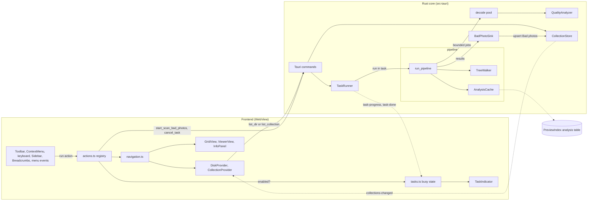
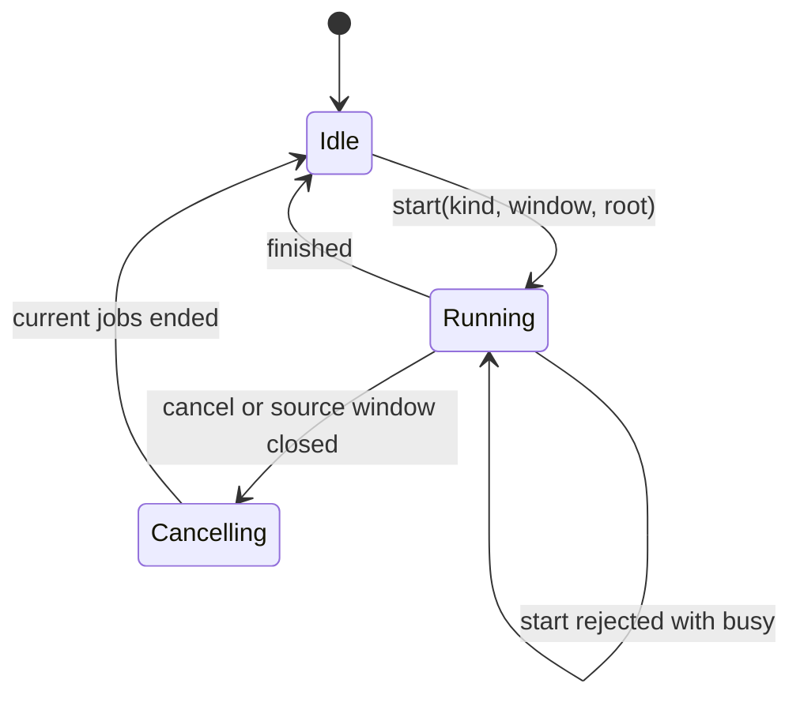
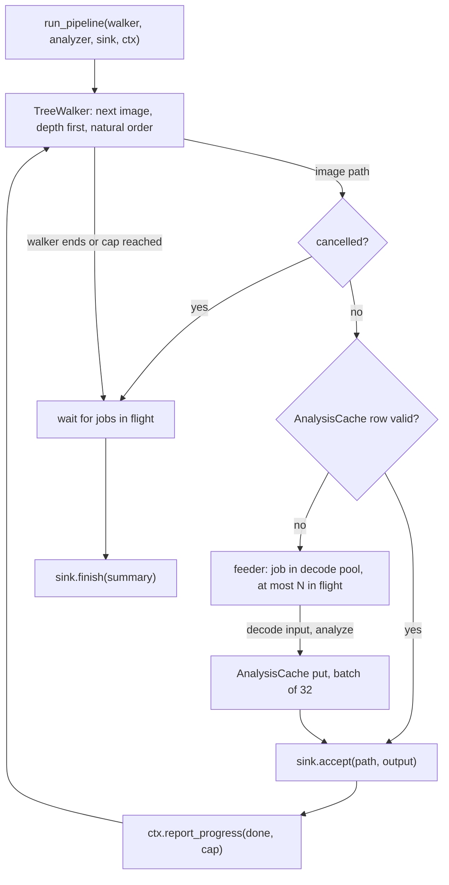
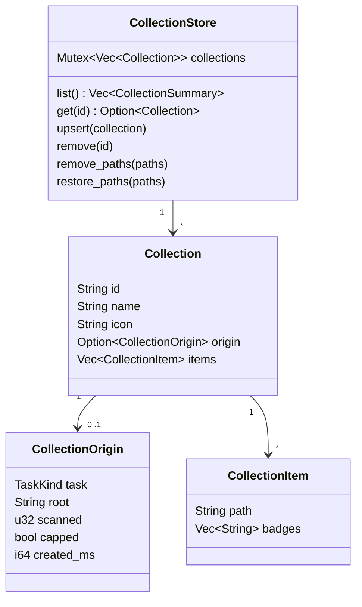
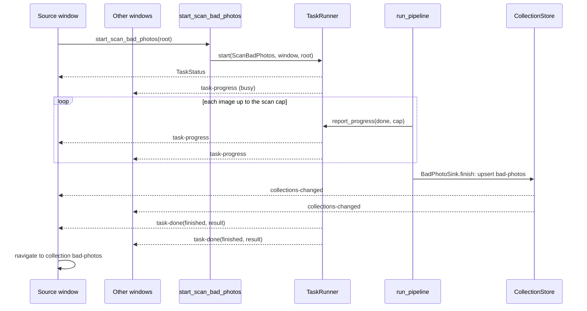

# Photo Quality Detection

## Summary

Photo quality detection finds bad photos in a folder tree: blurry, underexposed, overexposed, and low-contrast
images. The user starts a scan of a folder and all its subfolders from the context menu.

The scan stops at the scan cap: 200 photos by default, set in Settings. At the end, the app opens the in-memory
collection "Bad photos" as a virtual folder.

While the scan runs, the app blocks navigation and all actions that change files. The user reviews the bad photos in
the virtual folder and trashes them in edit mode (EDIT-01 to EDIT-07).

Phase 1 uses only deterministic algorithms, with no machine learning model and no new dependency. The algorithms are
Laplacian variance, the Tenengrad gradient, the Brenner gradient, and a luminance histogram.

> Rationale: a scan costs one image decode for each photo. That is more work than thumbnail generation, and it competes
> for the same decode threads. An automatic scan on folder open would break PERF-06 and PERF-07 while it runs. A scan on
> request, with a cap of at most 1,000 photos, keeps the cost under user control.

This feature introduces 4 parts that other features will reuse:

| Part                 | Layer    | Purpose                                                                   |
|----------------------|----------|---------------------------------------------------------------------------|
| `TaskRunner`         | Rust     | Runs 1 exclusive background task for the app, with progress and cancel    |
| Image scan pipeline  | Rust     | Walks a folder tree and runs an `ImageAnalyzer` on each photo, with cache |
| Locations            | Frontend | Disk folders and virtual folders behind one `LocationProvider` interface  |
| Action registry      | Frontend | One place that defines each user action and decides if it is enabled     |

> Rationale: the user stated that navigation, folder actions, the scan pipeline, and virtual folders will be reused by
> other features. The design therefore separates the generic parts from the photo quality parts. The photo quality
> feature is the first client of each generic part. Design Decisions D1 to D6 give the reasons for each split.

The keywords `MUST`, `MUST NOT`, `SHOULD`, and `MAY` have the meaning from RFC 2119.

## Terms

- **Task:** one long-running background job of the app, for example a scan. At most 1 task runs at a time.
- **Scan:** the task that detects bad photos in one folder tree.
- **Scan root:** the folder that the user starts the scan on.
- **Scan cap:** the maximum number of photos in one scan, the setting `scanCap`: 100 to 1,000, default 200.
- **Analyzer:** a component that computes one result from one image, for example `QualityAnalyzer`.
- **Collection:** an in-memory list of image paths from any folders. The app does not save it to disk.
- **Location:** the content source of a window: a disk folder or a collection.
- **Virtual folder:** the grid view of a collection location. It has no folder on disk.
- **Busy state:** the state of the app while a task runs.

## Context and Gap

| Existing                                                   | State today                                                         | Change                                                         |
|------------------------------------------------------------|---------------------------------------------------------------------|----------------------------------------------------------------|
| `decode::thumbnail_image` (`src-tauri/src/decode/mod.rs`)  | Decodes an oriented `CGImage` with a maximum long edge, through ImageIO subsampling | `pipeline::input` calls it to build the analysis input |
| `scan::read_entries` (`src-tauri/src/scan/mod.rs`)         | Reads one directory with options for hidden files and symbolic links | `TreeWalker` calls it for each folder of the tree              |
| `FolderPreviewService` (`src-tauri/src/scan/preview.rs`)   | Has its own depth-first walk with the skip rules FPV-09 and FPV-10   | Keeps its walk in this feature; moves to `TreeWalker` later (see Future Improvements) |
| `PreviewIndex` (`src-tauri/src/scan/index.rs`)             | SQLite tables `previews` and `taken`                                | New generic table `analysis`                                   |
| `pools::decode()` (`src-tauri/src/pools.rs`)               | Thread pool for decode, one thread per performance core (THM-12)     | Runs the analysis jobs, with a limit on jobs in flight         |
| `EditModeState` (`src-tauri/src/commands/edit.rs`)         | Rejects `trash_files` while edit mode is off (EDIT-05)               | `trash_files` and `undo_trash` also reject while a task runs   |
| `build_menu` (`src-tauri/src/lib.rs`)                      | Native items `new_window` and `open_folder`, always enabled          | `TaskRunner` disables them while a task runs                   |
| `AppState` (`src-tauri/src/lib.rs`)                        | Holds the services                                                  | New fields `tasks` and `collections`                           |
| `Entry` (`src-tauri/src/scan/mod.rs`, `src/lib/api.ts`)    | `n` is a file name relative to the open folder                       | New optional fields `p` (absolute path) and `b` (badge codes)  |
| `store.ts` (`src/lib/store.ts`, 455 lines)                 | Holds state, navigation, history, selection, and trash in one module | Navigation and history move to `navigation.ts`, based on `Location` |
| `entryPath` (`src/lib/store.ts`)                           | Joins `path()` and `Entry.n`; all file actions use it                | Returns `Entry.p` when it is present                           |
| Action call sites: `Toolbar.tsx`, `ContextMenu.tsx`, `keyboard.ts`, `Sidebar.tsx`, `Breadcrumbs.tsx`, `App.tsx` | Each file calls store functions directly and checks its own conditions | Each file calls the action registry                     |
| `DeleteFolderDialog` (`src/components/DeleteFolderDialog.tsx`) | Modal dialog in the window                                       | Reference pattern for `ScanCapDialog`                          |
| `Settings` (`src-tauri/src/commands/settings.rs`)          | No quality settings                                                  | New fields `quality_sensitivity` and `scan_cap`                |

> Context: `entryPath` is the only place that builds a file path from an entry. `App.tsx`, `keyboard.ts`,
> `ContextMenu.tsx`, `GridView.tsx`, `ViewerView.tsx`, and the trash actions in `store.ts` all call it. A change of
> `entryPath` makes the viewer, the info panel, copy, reveal, drag, and trash work in a virtual folder.

> Context: today the busy and enabled checks are spread over the call sites. For example, `Toolbar.tsx` disables
> Enclosing Folder with `path() === "/"`, and `keyboard.ts` calls `goParent` with its own checks. The menu event
> `menu-open-folder` in `App.tsx` calls `openFolderDialog` with no check. A block of all navigation during a scan needs
> one place for these checks (D4).

## System View



```text
src-tauri/src/
├── tasks/mod.rs            # TaskRunner, TaskContext, CancelToken, task events (generic)
├── pipeline/               # image scan pipeline (generic)
│   ├── walk.rs             #   TreeWalker
│   ├── analyzer.rs         #   ImageAnalyzer and ResultSink traits
│   ├── input.rs            #   AnalysisInput: decoded grayscale buffer
│   ├── cache.rs            #   AnalysisCache over the analysis table
│   └── run.rs              #   run_pipeline: walker, cache, bounded feeder, sink
├── collections.rs          # CollectionStore (generic)
├── quality/                # photo quality feature
│   ├── kernels.rs          #   Laplacian, Sobel, Brenner, histogram
│   ├── analyzer.rs         #   QualityAnalyzer: ImageAnalyzer
│   └── sink.rs             #   BadPhotoSink: ResultSink, thresholds, badges
├── scan/index.rs           # + analysis table
└── commands/               # + tasks.rs, collections.rs, quality.rs command modules
src/
├── lib/
│   ├── actions.ts          # action registry (generic)
│   ├── tasks.ts            # busy state from task events (generic)
│   ├── locations.ts        # Location, LocationProvider, providers (generic)
│   ├── navigation.ts       # navigate, history, current location (from store.ts)
│   ├── badges.ts           # badge code to label and icon
│   └── store.ts            # grid state, selection, trash
└── components/
    ├── TaskIndicator.tsx   # animated scan icon with percentage (generic)
    ├── ScanCapDialog.tsx   # information dialog for the scan cap
    └── Toolbar.tsx, ContextMenu.tsx, Tile.tsx, Breadcrumbs.tsx, InfoPanel.tsx  # changed
```

## Design Decisions

### D1: `TaskRunner` runs 1 exclusive task for the whole app

- **Decision:** `TaskRunner` in `AppState` holds at most 1 running task. Each task has a `TaskKind`, a source window,
  an optional root path, a `CancelToken`, and a progress value. `TaskRunner` emits the generic events `task-progress`
  and `task-done` to all windows.
- **Reason:** the user requires that navigation and file changes are blocked during a scan. A single app-wide task
  slot gives one clear busy state that all windows and all commands can check. Future tasks, for example a duplicate
  search, get the busy state, the progress indicator, and the cancel action with no new code.
- **Rejected:** a lock for each feature - each new feature then repeats the busy logic, and 2 features can run at once
  and compete for the decode threads.
- **Rejected:** a queue of several tasks - no feature needs it now, and the block of navigation makes a queue
  confusing to the user.
- **Revisit if:** a future task must run in the background without a block of the UI, for example an idle index
  build. Then add a non-exclusive task class next to the exclusive slot.

### D2: The image scan pipeline is generic over `ImageAnalyzer` and `ResultSink`

- **Decision:** `run_pipeline` connects 4 parts: a `TreeWalker` (source), an `AnalysisCache`, an `ImageAnalyzer`
  (work on each image), and a `ResultSink` (what to do with each result). The photo quality feature supplies only
  `QualityAnalyzer` and `BadPhotoSink`.
- **Reason:** the user stated that the scan pipeline will be extended and reused. The walk, the cap, the cache, the
  bounded feeder, the cancel, and the progress are the hard parts, and they are the same for each analyzer. A
  perceptual-hash analyzer for duplicates, for example, needs only a new analyzer and a new sink.
- **Rejected:** a photo-quality-only pipeline - fastest to write, but the next feature copies it.
- **Rejected:** dynamic plugins (`Box<dyn ImageAnalyzer>` registered at run time) - generic functions over the traits
  give static dispatch and are simpler. The analyzers are known at compile time.

### D3: `AnalysisCache` stores results of all analyzers in one table

- **Decision:** the SQLite table `analysis` has the key `(dir, name, analyzer)`. Each row holds the analyzer
  `version`, the file `mtime` and `size`, and the result as JSON.
- **Reason:** a new analyzer gets a persistent cache with no schema change. The `version` column lets an analyzer
  change its algorithm and make its old rows stale without a migration.
- **Rejected:** a table for each analyzer, like `taken` - each new analyzer then needs a schema change and its own
  stale logic.

### D4: The action registry is the only place that decides if an action is enabled

- **Decision:** `actions.ts` defines each user action once: id, label, shortcut, category, `enabled()`, and `run()`.
  Toolbar buttons, context menu items, keyboard shortcuts, sidebar and breadcrumb clicks, and native menu events call
  `runAction(id, args)`. `runAction` does nothing if `enabled()` is false.
- **Reason:** the busy state must block the same actions on every path: button, menu, shortcut, and native menu. Today
  each call site has its own checks (see Context and Gap), so a new block needs a change in 6 files and is easy to miss
  on 1 path. The registry also gives future features 1 place to add an action or a new block rule.
- **Rejected:** a `disabled={busy()}` check at each call site - it duplicates the rule, and a keyboard shortcut or a
  native menu item can bypass it.

### D5: A `Location` abstraction hides the difference between disk folders and virtual folders

- **Decision:** a window shows a `Location`: `{ kind: "disk", path }` or `{ kind: "collection", id }`. A
  `LocationProvider` for each kind lists the entries, builds the breadcrumbs, and declares its capabilities
  (`LocationCaps`). Navigation, history, the grid, and the action registry use only these interfaces.
- **Reason:** the user stated that virtual folders and navigation will be reused. With providers, a new virtual
  folder type, for example search results, adds 1 provider and no checks such as `path.startsWith("collection:")` in
  the views and actions.
- **Rejected:** a virtual path string with prefix checks at each use - simple at first, but each new feature adds more
  scattered checks.

### D6: The Rust core also enforces the busy state

- **Decision:** the commands that change files or app-wide data (`trash_files`, `undo_trash`, `clear_cache`,
  `new_window`, `remove_collection`, and each task start command) return `CmdError` with kind `busy` while a task
  runs. `TaskRunner` disables the native menu items `new_window` and `open_folder` while a task runs.
- **Reason:** this is the same defense in depth as EDIT-05 for edit mode. A frontend bug or a second window cannot
  change files in the tree that the scan reads.
- **Rejected:** a frontend-only block - it depends on each window having the current busy state.

## Algorithms

### The analyzer works on a normalized grayscale buffer

1. `pipeline::input` decodes the image with `decode::thumbnail_image(path, edge)`.
2. It draws the `CGImage` into an 8-bit `CGBitmapContext` with a `DeviceGray` color space.
3. `QualityAnalyzer` reads this buffer of `u8` luminance values.

| Constant        | Value   | Purpose                                                         |
|-----------------|---------|-----------------------------------------------------------------|
| `ANALYSIS_EDGE` | 1024 px | Long edge of the analysis buffer for `QualityAnalyzer`          |
| `TILE`          | 128 px  | Side of one tile for the local sharpness metric                 |
| `ALGO_VERSION`  | 1       | `QualityAnalyzer` version; a change makes its cached rows stale |

> Rationale: Laplacian variance and gradient metrics depend on the image scale. A downscale by 2 makes edges look
> sharper, so a blurry 48 MP photo and a blurry 12 MP photo give different values at full size. A fixed analysis size
> makes one threshold valid for all cameras. 1024 px keeps enough detail to see focus blur, and the JPEG path of
> `thumbnail_image` gets it from a 1/4 subsampled DCT decode, which is fast. The 512 px thumbnail from `ThumbCache` is
> rejected as input: the downscale hides moderate blur, and the JPEG compression at quality 80 adds block edges that
> raise the Laplacian response.

> Rationale for `AnalysisInput` in the pipeline: each analyzer declares the input it needs (`InputSpec`, for example
> `Gray { edge: 1024 }`). The decode is in the pipeline, not in the analyzer, so a future run of 2 analyzers with the
> same input can share 1 decode.

> Assumption: 1024 px is a good balance of speed and accuracy. Verify with the calibration tool (see Verification):
> compare the separation of sharp and blurry samples at 768, 1024, and 1536 px.

> Rationale for grayscale through CoreGraphics: `DeviceGray` drawing does the color conversion in optimized native
> code. A conversion in Rust from RGBA is also acceptable if the benchmark shows it is faster.

### The analyzer computes these metrics

| Metric field       | Algorithm                                                                                     | Meaning                         |
|--------------------|-----------------------------------------------------------------------------------------------|---------------------------------|
| `lap_var`          | Variance of the 3×3 Laplacian `[0 1 0; 1 -4 1; 0 1 0]` over all interior pixels              | Global sharpness                |
| `lap_var_local`    | 90th percentile of the per-tile Laplacian variances                                           | Sharpness of the sharpest areas |
| `tenengrad`        | Mean of `Gx² + Gy²` from the 3×3 Sobel operators                                              | Gradient sharpness              |
| `brenner`          | Mean of `(I(x+2, y) − I(x, y))²`                                                              | Cheap gradient sharpness        |
| `mean_luma`        | Mean of all luminance values, 0 to 255                                                        | Overall brightness              |
| `std_luma`         | Standard deviation of the luminance values                                                    | Global contrast                 |
| `clip_dark`        | Fraction of pixels with luminance ≤ 5                                                         | Crushed shadows                 |
| `clip_bright`      | Fraction of pixels with luminance ≥ 250                                                       | Blown highlights                |

- `kernels.rs` computes the Laplacian, the Sobel, the Brenner, and the histogram values in one pass over the buffer.
- `kernels.rs` uses integer arithmetic (`i32` per pixel, `i64` or `f64` sums) and no `unsafe` code.

> Rationale for the local metric: a portrait with a sharp subject and a blurred background (shallow depth of field)
> has a low global Laplacian variance. The global metric flags it as blurry, which is a false positive. The sharpest
> tiles describe the focus of the subject. The 90th percentile ignores 1 or 2 tiles with noise or a hard text edge.
> `lap_var_local` is the primary blur metric for this reason.

> Rationale for all 3 sharpness metrics: the request is to start with the algorithmic approach and compare. Phase 1
> stores all 3 so that the calibration tool can show which metric separates the user's sample set best. The verdict
> uses only `lap_var_local` until calibration shows a better choice.

> Source: Laplacian variance as a blur measure: Pech-Pacheco et al., "Diatom autofocusing in brightfield microscopy: a
> comparative study", ICPR 2000. Tenengrad and Brenner: Krotkov, "Focusing", IJCV 1987, and Brenner et al. 1976, as
> compared in Pertuz et al., "Analysis of focus measure operators for shape-from-focus", Pattern Recognition 2013.

### `BadPhotoSink` assigns flags from the metrics

| Flag          | Badge code              | Condition                                  | Default threshold                         |
|---------------|-------------------------|--------------------------------------------|-------------------------------------------|
| `blurry`      | `quality.blurry`        | `lap_var_local < blur_threshold`           | `blur_threshold` = 100                    |
| `underexposed`| `quality.underexposed`  | `mean_luma < 50` and `clip_dark > 0.40`    | `dark_mean` = 50, `dark_clip` = 0.40      |
| `overexposed` | `quality.overexposed`   | `mean_luma > 205` and `clip_bright > 0.25` | `bright_mean` = 205, `bright_clip` = 0.25 |
| `low_contrast`| `quality.lowContrast`   | `std_luma < 20`                            | `contrast_min` = 20                       |

- An image with 1 or more flags is bad. `BadPhotoSink` adds each bad image to the collection with its badge codes.
- The sensitivity setting (`low`, `medium`, `high`) multiplies `blur_threshold` by 0.5, 1.0, or 2.0.
- `BadPhotoSink` applies the thresholds. The cache stores only the metrics, so a new sensitivity needs no new analysis.

> Rationale for the thresholds in the sink, not in the analyzer: the cached metrics stay valid when the thresholds
> change during calibration or with the sensitivity setting. A cached verdict does not.

> Assumption: all default thresholds are guesses. The value 100 for Laplacian variance is the common value from OpenCV
> tutorials, for images of about 500 to 1000 px. The exposure values are first estimates. Calibrate each value on a set
> of real photos before release (see Verification), and update this table.

> Risk: a night photo, a snow scene, and a low-key studio photo are underexposed or overexposed by the histogram
> rules but are correct. The `mean_luma` and `clip_*` conditions together reduce these false positives. The badge shows
> the reason, and the user decides. The detector never acts on its own.

> Risk: sensor noise at high ISO raises the Laplacian variance, so a noisy blurry photo can pass as sharp. The
> downscale to 1024 px averages most of the noise. If calibration shows false negatives, add a 3×3 Gaussian blur
> before the Laplacian and record the change as `ALGO_VERSION` 2.

## Generic Components

### `TaskRunner` manages the busy state



- `TaskRunner::start` returns `TaskStatus`, or the error `busy` if a task runs.
- `TaskRunner::start` gives the task function a `TaskContext`: the `CancelToken`, `report_progress(done, total)`, and
  the `AppHandle`.
- `TaskRunner` emits `task-progress` to all windows at most every 100 ms.
- `TaskRunner` emits `task-done` to all windows with the outcome `finished`, `cancelled`, or `failed`. Its `result`
  value is defined by the task kind.
- `TaskRunner::guard()` returns `Err(busy)` while a task runs. Commands that change files or app-wide data call it.
- `TaskRunner` disables the native menu items `new_window` and `open_folder` at the start and enables them at the end.
- A close of the source window cancels its task.
- A window that opens or reloads calls `get_task_status` to get the current busy state.

| Type          | Fields                                                              | Defined in                     |
|---------------|---------------------------------------------------------------------|--------------------------------|
| `TaskKind`    | Enum; first value `ScanBadPhotos`                                   | `src-tauri/src/tasks/mod.rs`   |
| `TaskStatus`  | `id`, `kind`, `window`, `root`, `done`, `total`                     | `src-tauri/src/tasks/mod.rs`   |
| `TaskDone`    | `id`, `kind`, `window`, `root`, `outcome`, `result` (JSON)          | `src-tauri/src/tasks/mod.rs`   |
| `CancelToken` | Shared `AtomicBool`; `is_cancelled()`                               | `src-tauri/src/tasks/mod.rs`   |

> Rationale for the 100 ms progress interval: the percentage on the folder tile needs smooth updates, and 10 events
> per second are cheap for IPC.

### The image scan pipeline runs an analyzer over a folder tree



```rust
// Defined in src-tauri/src/pipeline/analyzer.rs. Interface sketch; names are binding, bodies are not.
pub trait ImageAnalyzer: Send + Sync + 'static {
    const ID: &'static str;          // cache key part, for example "quality"
    const VERSION: u32;              // a change makes cached rows of this analyzer stale
    type Output: Serialize + DeserializeOwned + Send + 'static;
    fn input(&self) -> InputSpec;    // the decoded input this analyzer needs
    fn analyze(&self, input: &AnalysisInput) -> Option<Self::Output>; // None: image cannot be analyzed
}

pub trait ResultSink<O>: Send {
    fn accept(&mut self, path: &Path, output: &O);  // called in walk order
    fn failed(&mut self, path: &Path);              // decode or analysis failed
    fn finish(self, summary: &PipelineSummary) -> serde_json::Value; // becomes TaskDone.result
}
```

- `TreeWalker` reads folders with `scan::read_entries`, depth first, in natural name order (GRID-11).
- `WalkOptions` has `max_depth: Option<usize>` and `max_images: Option<usize>`, and always applies FPV-09 and FPV-10.
- `TreeWalker` skips a folder that it cannot read and continues with the next folder.
- `TreeWalker` sets `capped` only if it finds 1 more image after `max_images`.
- The feeder keeps at most `perf_cores() / 2` jobs in the decode pool, with a minimum of 1.
- `run_pipeline` calls `sink.accept` in walk order, also when jobs end in another order.
- A cached image and an image that fails to decode both count toward `max_images`.
- `PipelineSummary` holds `scanned`, `analyzed`, `cached`, `failed`, `capped`, and `cancelled`.

> Rationale for the cap check: without the look-ahead of 1 image, a tree with exactly cap photos reports `capped`, and
> the dialog tells the user that photos were not scanned. That is false.

> Rationale for counting cached images: the cap limits the size of the result and the worst-case run time. A count of
> only new analyses makes the cap meaningless on a second scan, because the scan then reads the whole tree.

> Rationale for the job limit: the decode pool takes jobs in FIFO order from its global queue. If the pipeline sends
> all jobs at once, a new thumbnail request waits behind all of them (GRID-09, PERF-06). With at most
> `perf_cores() / 2` jobs in flight, a thumbnail job waits for at most 1 analysis job. A separate pool is rejected: it
> would exceed the thread limit of THM-12.

> Rationale for the walk order of `accept`: the collection must list photos in the same order on each scan of the same
> tree. The pipeline keeps a small reorder buffer, bounded by the number of jobs in flight.

> Risk: a tree with many folders and few images, for example a source code tree, makes the walker read many folders
> before it reaches the cap. The walker runs on the `scan` pool and checks the `CancelToken` before each folder. If
> this is slow in practice, add `max_folders` to `WalkOptions`.

### `CollectionStore` holds the in-memory collections



- `upsert` replaces a collection with the same id.
- Each change emits `collections-changed` with the `CollectionSummary` list to all windows.
- `trash_files` calls `remove_paths` for the trashed paths. `undo_trash` calls `restore_paths`.
- `restore_paths` puts each path back at its original position.
- `CollectionItem.badges` holds badge codes such as `quality.blurry`. The frontend maps codes to labels in `badges.ts`.

> Rationale for badge codes: `CollectionStore` does not know the photo quality feature. A future collection, for
> example duplicates, uses its own codes such as `duplicate.group`, with no change to the store.

> Rationale for the store in Rust: all windows share one collection list, and a reload of a WebView does not lose it.

### Locations and providers define what a window shows

```typescript
// Defined in src/lib/locations.ts.
type Location =
    | { kind: "disk"; path: string }          // a folder on disk
    | { kind: "collection"; id: string };     // an in-memory collection

interface LocationCaps {
    parent: boolean;        // Enclosing Folder (⌘↑) is possible
    favorites: boolean;     // the location can be a favorite
    recents: boolean;       // the location goes to Recents and lastFolder
    folderPrefs: boolean;   // sort and tile size are stored per location
    folderTiles: boolean;   // the listing can contain folders
    watch: boolean;         // FsWatcher watches the location
    scan: boolean;          // a scan can start from the location
}

interface LocationProvider<L extends Location> {
    list(loc: L, sort: SortSpec, showHidden: boolean): Promise<DirListing>; // entries in grid order
    title(loc: L): string;                       // window title
    crumbs(loc: L): Crumb[];                      // breadcrumb components, each with a target Location
    caps(loc: L): LocationCaps;                  // capabilities for actions and views
}

function locationKey(loc: Location): string;   // stable string: the disk path, or "collection:<id>"
function parseLocation(key: string): Location; // inverse of locationKey, for history and window restore
```

- `navigation.ts` holds the current `Location`, the back and forward history as `Location` values, and `navigate`.
- `navigate` selects the provider by `loc.kind`. It does not contain any kind-specific code.
- `DiskProvider` calls `list_dir`. `CollectionProvider` calls `list_collection`.
- `CollectionProvider` returns `caps` with all fields false.
- `CollectionProvider` re-lists the current collection on `collections-changed`.

### The action registry decides what the user can do

```typescript
// Defined in src/lib/actions.ts.
type ActionCategory =
    | "navigation"   // changes the location of a window, or opens a window
    | "fileChange"   // changes files or folders on disk
    | "dataChange"   // changes app-wide data, for example clear cache
    | "task"         // starts or cancels a task
    | "view";        // changes only the view: selection, viewer, zoom, sort, info panel

interface Action<A = void> {
    id: ActionId;                     // for example "nav.back", "file.trash", "task.scanBadPhotos"
    label: (args: A) => string;       // menu and tooltip text
    shortcut?: string;                // display text, for example "⌘["
    category: ActionCategory;         // used by the busy rule
    enabled: (args: A) => boolean;    // feature rule, for example edit mode or LocationCaps
    run: (args: A) => void | Promise<void>;
}

function isEnabled(id: ActionId, args?: unknown): boolean; // busy rule AND action.enabled
function runAction(id: ActionId, args?: unknown): void;    // no-op if not enabled
```

| Category     | Enabled while busy | Examples                                                                    |
|--------------|--------------------|-----------------------------------------------------------------------------|
| `navigation` | No                 | Back, Forward, Enclosing Folder, breadcrumb, sidebar, open folder tile, Open Folder (⌘O), New Window (⌘N), open collection |
| `fileChange` | No                 | Move to Trash, Undo, Delete Folder                                          |
| `dataChange` | No                 | Clear Cache, Remove Collection                                              |
| `task`       | Only Cancel        | Scan for Bad Photos (No), Cancel Scan (Yes)                                 |
| `view`       | Yes                | Selection, viewer, zoom, sort, tile size, info panel, show hidden files, copy, reveal |

- Toolbar, `ContextMenu`, `keyboard.ts`, `Sidebar`, `Breadcrumbs`, and the native menu events call `runAction`.
- A button or menu item reads `isEnabled` for its disabled state. A disabled context menu item is shown greyed out.
- Edit mode on and off stays enabled while busy. The file changes stay blocked by the `fileChange` rule.

> Rationale for `view` actions while busy: they read files but do not change files or the location. The user can
> select and open photos in the viewer during a scan.

> Assumption: the request blocks "navigation and folder modification actions". This spec treats the viewer, sort, and
> show hidden files as `view` actions, because they keep the window in the same folder. Change their category in
> `actions.ts` if they must be blocked too.

## Behavior

### The user starts a scan from the context menu

- The action `task.scanBadPhotos` has the label "Scan for Bad Photos". It appears in 2 context menus:
  - The menu of the grid background. The scan root is the current folder.
  - The menu of a selection of exactly 1 folder tile. The scan root is that folder.
- `task.scanBadPhotos` requires `LocationCaps.scan`, so it is not available in a virtual folder.
- While a task runs, both menus show `task.cancel` with the label "Cancel Scan" in its place.
- A scan does not change files, so `task.scanBadPhotos` is available in both edit mode states.

### The scan runs as a task



- `start_scan_bad_photos` reads `scan_cap` and `quality_sensitivity` from Settings at the start.
- The scan uses `WalkOptions { max_depth: None, max_images: Some(scan_cap) }`.
- `TaskDone.result` for a scan is `{ collectionId, found, scanned, capped }`.
- A cancelled scan does not change the "Bad photos" collection and does not navigate.

> Rationale for no depth limit: the request is to scan all subfolders until the cap. The scan cap bounds the work.
> The `preview_depth` setting (SET-03) applies only to folder previews.

### The app shows the scan progress on the scanned folder

- `TaskIndicator` shows an animated scan icon and the percentage `floor(done × 100 / cap)`, for example "35 %".
- `TaskIndicator` shows on the folder tile whose path is the task root, over the folder preview.
- If the task root is the current folder, `TaskIndicator` shows on the last breadcrumb component.
- The toolbar shows a small `TaskIndicator` in all windows. Its tooltip is "Scanning for bad photos: 70 / 200".
- The status bar shows the same text.
- `TaskIndicator` reads only `tasks.ts`. Any task with a root shows on that root with no feature code.
- If the walker ends before the cap, the indicator shows 100 % before the virtual folder opens.
- The animation respects the macOS "Reduce motion" setting (A11Y-03): it shows a static icon and the percentage.

> Rationale for the cap as the total: a count of all images in the tree before the scan costs a full walk of the tree,
> which can take longer than the scan. For a tree with fewer photos, the percentage jumps to 100 % at the end.

> Rationale for the indicator on the tile and the breadcrumb: the user wants to see which folder is scanned and when
> the scan ends. Navigation is blocked, so the scanned folder or its parent stays on screen for the whole scan.

### The app opens "Bad photos" when the scan finishes

- At `task-done` with outcome `finished`, the source window navigates to `{ kind: "collection", id: "bad-photos" }`.
- This navigation is pushed to the history, so Back returns to the scanned folder.
- The other windows do not navigate. They update the Collections menu.
- The source window then shows the result:
  - Not capped: a toast, for example "Found 23 bad photos in 140 photos."
  - Capped: the `ScanCapDialog` over the virtual folder.
- The virtual folder shows "No bad photos found" if the collection is empty.

> Rationale: the auto-open is a direct call of `navigate`, not of the `nav.openCollection` action. It runs after
> `TaskRunner` clears the busy state, so the busy rule does not block it.

### The `ScanCapDialog` informs the user about the cap

- Title: "Scan Stopped at <cap> Photos", for example "Scan Stopped at 200 Photos".
- Text: "The folder “<scan root name>” has more photos. Found <found> bad photos in the first <cap> photos. Scan a
  subfolder, or raise the scan limit in Settings."
- Button: "OK". `Return` and `Escape` close the dialog.

> Context: `DeleteFolderDialog.tsx` is a modal dialog in the window. Use its structure and styles. The dialog MUST NOT
> be a browser `alert()`, because a native alert blocks the WebView.

### The toolbar shows the virtual folders

- The toolbar has a Collections button between the sort controls and the edit mode button.
- A click opens a menu through the existing `showMenu` in `ContextMenu.tsx`. Each item runs an action.

| Menu item                                   | Shown when              | Action                     |
|---------------------------------------------|-------------------------|----------------------------|
| One item per collection, "Bad photos (23)"  | 1 or more collections   | `nav.openCollection`       |
| "No Collections" (disabled)                 | No collection exists    | None                       |
| "Cancel Scan"                               | A task runs             | `task.cancel`              |

- The button shows the state `on` while the window shows a virtual folder.
- While a task runs, the collection items are disabled, because `nav.openCollection` is a `navigation` action.

### The grid shows a virtual folder

- `list_collection` returns `Entry` values with `p` (absolute path) and `b` (badge codes). `n` is the file name.
- The grid shows images only. A virtual folder has no folder tiles and no folder previews.
- Sort by name, date modified, and size apply. Sort by date taken uses `fill_taken` for each parent folder.
- The breadcrumbs show "Collections › Bad photos". The tile tooltip shows the folder of the file.
- Each tile with badges shows a badge with the labels from `badges.ts`, for example "Blurry, Underexposed".
- The viewer, the info panel, copy, reveal, drag, and Open With work through `entryPath`.
- In edit mode, Move to Trash and Undo work as in a disk folder (FILE-01 to FILE-08).
- `list_collection` removes paths that do not exist.
- The background context menu has "Remove Collection" (`data.removeCollection`).

> Rationale for `Entry.p` and `Entry.b`: all file actions go through `entryPath`. The optional fields keep the disk
> listing unchanged and add no bytes to `list_dir` results (`skip_serializing_if`), so PERF-05 is not affected.

> Rationale for no restore of virtual locations: a collection is lost when the app quits. A restore of `lastFolder` to
> a lost collection shows an error at start. `LocationCaps.recents` = false prevents it.

### The cache keeps results valid

- An `analysis` row is stale when its `mtime`, its `size`, or its `version` differs from the current value.
- The pipeline reuses rows that are not stale and analyzes the other images again.
- `clear_cache` also clears the `analysis` table. `clear_cache` is blocked while a task runs (D6).

> Rationale: this is the same approach as the `taken` table, which also relies on the `mtime` check. It adds no work
> to the `FsWatcher` thread.

## Data Model

### SQLite table `analysis` in `PreviewIndex`

| Column     | Type    | Purpose                                            |
|------------|---------|----------------------------------------------------|
| `dir`      | TEXT    | Folder path (primary key part 1)                   |
| `name`     | TEXT    | File name (primary key part 2)                     |
| `analyzer` | TEXT    | `ImageAnalyzer::ID` (primary key part 3)           |
| `version`  | INTEGER | `ImageAnalyzer::VERSION` at analysis time          |
| `mtime`    | INTEGER | File modification time in ms, for the stale check  |
| `size`     | INTEGER | File size in bytes, for the stale check            |
| `data`     | TEXT    | `ImageAnalyzer::Output` as JSON                    |

### Settings

| Setting               | Type  | Range or values          | Default  |
|-----------------------|-------|--------------------------|----------|
| `quality_sensitivity` | enum  | `low`, `medium`, `high`  | `medium` |
| `scan_cap`            | `u32` | 100 to 1,000, step 100   | 200      |

- `SettingsStore::update` clamps `scan_cap` to the range, as it does for `preview_depth` (SET-03).
- `SettingsView.tsx` shows `quality_sensitivity` as a 3-way control.
- `SettingsView.tsx` shows `scan_cap` as a slider labelled "Bad photo scan limit", with the current value.

> Rationale for the default of 200: a scan of 200 new photos takes about 4 s on the M1 at the QUAL-24 budget. That is
> a short wait for a first try. The maximum of 1,000 bounds the worst case to about 20 s.

> Assumption: the step of 100 was not specified. It gives 10 slider positions. Change it if a finer step is wanted.

### Types

| Type                 | Purpose                                                          | Defined in                            |
|----------------------|------------------------------------------------------------------|---------------------------------------|
| `QualityMetrics`     | The 8 metric values; `QualityAnalyzer::Output`                   | `src-tauri/src/quality/analyzer.rs`   |
| `QualityFlag`        | `blurry`, `underexposed`, `overexposed`, `lowContrast`           | `src-tauri/src/quality/sink.rs`       |
| `InputSpec`, `AnalysisInput` | Requested and decoded analysis input                     | `src-tauri/src/pipeline/input.rs`     |
| `WalkOptions`, `PipelineSummary` | Walker options and the pipeline result counts        | `src-tauri/src/pipeline/`             |
| Task types           | See the table in the `TaskRunner` section                        | `src-tauri/src/tasks/mod.rs`          |
| Collection types     | See the class diagram; plus `CollectionSummary` (`id`, `name`, `icon`, `count`) | `src-tauri/src/collections.rs` |
| `Location`, `LocationCaps`, `LocationProvider` | See the interface above                | `src/lib/locations.ts`                |
| `Action`, `ActionCategory`, `ActionId` | See the interface above                        | `src/lib/actions.ts`                  |
| TypeScript mirrors of the Rust types | For the commands and events                      | `src/lib/api.ts`                      |

### Commands and events

| Name                    | Kind    | Input           | Output                                                    |
|-------------------------|---------|-----------------|-----------------------------------------------------------|
| `get_task_status`       | command | none            | `TaskStatus` or `null`                                    |
| `cancel_task`           | command | none            | none                                                      |
| `start_scan_bad_photos` | command | `root`          | `TaskStatus`, or the error `busy`                         |
| `list_collections`      | command | none            | `CollectionSummary[]`                                     |
| `list_collection`       | command | `id`, `sort`    | `DirListing` with `Entry.p` and `Entry.b`                 |
| `remove_collection`     | command | `id`            | none, or the error `busy`                                 |
| `get_quality`           | command | `path`          | `QualityMetrics` and flags (cache, else analysis)         |
| `task-progress`         | event   | none            | `TaskStatus` to all windows                               |
| `task-done`             | event   | none            | `TaskDone` to all windows                                 |
| `collections-changed`   | event   | none            | `CollectionSummary[]` to all windows                      |

- `CmdError.kind` gets the new value `busy`.
- Each new command needs a permission file in `src-tauri/permissions/` and an entry in
  `src-tauri/capabilities/default.json` (SEC-02).
- A future task kind adds 1 start command, for example `start_find_duplicates`. It reuses the other task commands and
  events.

## Requirements

### Tasks and busy state

- [ ] **QUAL-01** `TaskRunner` MUST run at most 1 task at a time for the whole app.
- [ ] **QUAL-02** While a task runs, all windows MUST block the `navigation`, `fileChange`, and `dataChange` actions.
- [ ] **QUAL-03** While a task runs, the commands of D6 MUST return the error `busy`.
- [ ] **QUAL-04** While a task runs, the native menu items New Window and Open Folder MUST be disabled.
- [ ] **QUAL-05** The user MUST be able to cancel a running task from the context menu and the Collections menu.
- [ ] **QUAL-06** Each action MUST be defined once in `actions.ts`. All call sites MUST use `runAction` and `isEnabled`.

### Scan

- [ ] **QUAL-07** The context menu of the grid background and of 1 selected folder tile MUST have "Scan for Bad
  Photos".
- [ ] **QUAL-08** The app MUST NOT start a scan without a user request.
- [ ] **QUAL-09** The scan MUST read the scan root and all its subfolders, depth first, with the rules FPV-09 and
  FPV-10.
- [ ] **QUAL-10** The scan MUST stop at the scan cap.
- [ ] **QUAL-11** The scanned folder MUST show an animated scan icon and the percentage while the scan runs.
- [ ] **QUAL-12** After a finished scan, the source window MUST open the "Bad photos" virtual folder.
- [ ] **QUAL-13** The app MUST show the `ScanCapDialog` if the scan stopped at the cap and the tree has more photos.

### Pipeline and analysis

- [ ] **QUAL-14** The pipeline MUST NOT contain code that is specific to photo quality.
- [ ] **QUAL-15** `QualityAnalyzer` MUST compute the metrics on a grayscale buffer with a long edge of `ANALYSIS_EDGE`.
- [ ] **QUAL-16** `BadPhotoSink` MUST use `lap_var_local` for the `blurry` flag.
- [ ] **QUAL-17** The pipeline MUST store analyzer results in the `analysis` table and reuse rows that are not stale.
- [ ] **QUAL-18** The pipeline MUST keep at most `perf_cores() / 2` jobs in the decode pool.

### Collections and virtual folders

- [ ] **QUAL-19** After a finished scan, the app MUST replace the "Bad photos" collection.
- [ ] **QUAL-20** The collections MUST exist only in memory and MUST be shared by all windows.
- [ ] **QUAL-21** The toolbar MUST have a Collections button with a menu that opens each collection.
- [ ] **QUAL-22** A virtual folder MUST support the viewer, the info panel, sort, selection, and FILE-01 to FILE-14.
- [ ] **QUAL-23** Each tile in a virtual folder MUST show its badges. The info panel MUST show the quality metrics.

### Settings, safety, and performance

- [ ] **QUAL-24** The analysis of one 24 MP JPEG MUST take 40 ms or less on the reference machine.
- [ ] **QUAL-25** Settings MUST contain the sensitivity.
- [ ] **QUAL-26** Settings MUST contain the scan cap as a slider: minimum 100, default 200, maximum 1,000.
- [ ] **QUAL-27** The app MUST NOT change or move a file because of a scan result.
- [ ] **QUAL-28** PERF-06 and PERF-07 MUST pass while a scan runs.
- [ ] **QUAL-29** The implementation MUST NOT add a new crate dependency.

> Rationale for QUAL-24: PERF-07 allows 30 ms for a 256 px thumbnail. The analysis decodes at 1024 px, which costs
> more, and adds about 1 MP of kernel work. At 40 ms, a scan at the maximum cap of 1,000 new photos takes about 20 s
> on the M1 (2 analysis threads) and about 8 s on the M4 Pro (5 analysis threads). A second scan of the same tree
> reads the cache and takes less than 1 s.

> Assumption: the 40 ms budget is an estimate from the PERF-07 result (17.6 ms on the M4 Pro). Measure it with the new
> benchmark row before the value is final.

> Rationale for QUAL-29: OpenCV gives the same metrics, but it adds tens of MB to the bundle (PERF-01 allows 15 MB) and
> a C++ build dependency. The kernels are about 150 lines of Rust.

## Verification

- [ ] Unit tests in `kernels.rs`: a flat image gives 0 for all sharpness metrics. A box-blurred checkerboard gives
  lower values than the original checkerboard.
- [ ] Unit tests in `quality/sink.rs`: a black image gets `underexposed`; a white image gets `overexposed`.
- [ ] Unit tests in `walk.rs` use a cap of 100. Trees with 99, 100, and 101 photos give `capped` = false, false,
  true.
- [ ] Unit tests in `walk.rs`: the walk skips hidden folders, package folders, and symbolic links.
- [ ] Unit tests in `run.rs` use a test analyzer. `accept` gets the walk order, and a second run reads only the cache.
- [ ] Unit tests in `run.rs`: a version change analyzes again, and a cancel stops the walk.
- [ ] Unit tests in `tasks/mod.rs`: a second `start` returns `busy`; `guard` fails while a task runs.
- [ ] Unit tests in `collections.rs`: `remove_paths` and `restore_paths` keep the order.
- [ ] Unit tests for `actions.ts` (or a scripted run): each `navigation`, `fileChange`, and `dataChange` action is
  disabled while busy.
- [ ] Benchmark row in `src-tauri/benches/core.rs`: analysis of the generated 24 MP photo (QUAL-24). Record the result
  in `docs/benchmarks.md`.
- [ ] Calibration example `src-tauri/examples/quality_dump.rs`: prints the metrics of each image in a folder as CSV.
  Run it on a labelled set of 50 or more sharp and 50 or more blurry photos. Set `blur_threshold` from the result.
- [ ] Scripted run with `FG_DEV_SCRIPT`: start a scan on a tree with 10,000 photos and scroll the grid. PERF-06 and
  PERF-08 MUST pass (QUAL-28). Try ⌘[, ⌘↑, ⌘N, and ⌘⌫: nothing happens.

> Context: the `examples/example gallery/` folder has 6 photos in 3 folders. It is a good test for the recursive walk,
> but too small for calibration. Use a personal photo library with images marked by hand, and add 2 or 3 small blurry
> and sharp samples to `examples/` for the unit tests.

## Tasks

The generic parts come first, so the photo quality feature is their first client.

- [ ] Add `tasks/mod.rs` with `TaskRunner`, the events, the menu item state, and the unit tests (D1, D6).
- [ ] Add `guard()` calls to `trash_files`, `undo_trash`, `clear_cache`, and `new_window` (D6).
- [ ] Add the `analysis` table and `AnalysisCache` (D3).
- [ ] Add `pipeline/` with `TreeWalker`, the traits, `AnalysisInput`, `run_pipeline`, and the unit tests (D2).
- [ ] Add `collections.rs` with `CollectionStore` and its unit tests. Connect `trash_files` and `undo_trash`.
- [ ] Add `Entry.p` and `Entry.b` in Rust and TypeScript. Change `entryPath` to use `p`.
- [ ] Add `locations.ts` with `DiskProvider` and `CollectionProvider` (D5).
- [ ] Move navigation and history from `store.ts` to `navigation.ts`, based on `Location`.
- [ ] Add `actions.ts` and `tasks.ts`. Move all existing actions into the registry (D4).
- [ ] Change all call sites to `runAction` and `isEnabled`. The call sites are listed in Context and Gap.
- [ ] Add `TaskIndicator.tsx` on folder tiles, the last breadcrumb, the toolbar, and the status bar.
- [ ] Add `quality/kernels.rs`, `QualityAnalyzer`, and `BadPhotoSink`.
- [ ] Add `start_scan_bad_photos` and the other commands, permissions, and capability entries.
- [ ] Add the Collections button, the context menu items, `ScanCapDialog.tsx`, the result toast, and the auto-open.
- [ ] Add the virtual folder breadcrumbs, the tile badges, the empty state, and the info panel rows.
- [ ] Add `quality_sensitivity` and `scan_cap` to `Settings`, with the clamp, and to `SettingsView.tsx`.
- [ ] Add the benchmark row and the calibration example. Calibrate the thresholds.
- [ ] After implementation, move D1 to D6 to `docs/architecture-adr.md`. Add the QUAL requirements to
  `docs/requirements.md`.

> Rationale for the order: the action registry and the location refactor touch most frontend files. They are done
> before the feature UI, so the feature code uses the new interfaces from the start and no call site is changed twice.

## Limitations

- The scan finds focus blur and strong motion blur. It does not reliably find slight camera shake, because the
  downscale to 1024 px hides blur of 1 or 2 pixels at full size.
- The metrics do not judge composition, closed eyes, or aesthetic value. These need machine learning (see Future
  Improvements).
- A photo with intentional blur, for example a long exposure or a panning shot, gets the `blurry` flag.
- RAW files use the embedded preview through `thumbnail_image`. The result describes the camera JPEG rendering.
- The scan covers only the first photos in walk order, up to the scan cap. The user scans the other photos from a
  subfolder, or raises the cap in Settings.
- The app does not save collections. They are lost when the app quits.
- The user cannot navigate during a scan. A scan at the maximum cap can block navigation for about 20 s on the M1.

## Clarifications

- **The app keeps only 1 "Bad photos" collection.** A new scan replaces it. Separate collections for each scan root
  have no use: a scan starts only from a folder context menu. A virtual folder shows only photos and no folder tiles.
  The user cannot start a scan from inside a collection.
- **The cap dialog has no "Scan Next" action.** The user scans a subfolder, or raises the scan cap in Settings.
- **The sensitivity setting stays.** It changes `blur_threshold` and needs no new analysis.
- **The source window opens "Bad photos" at once when the scan finishes.** It does this also for an empty result.

## Future Improvements

- Move `FolderPreviewService` to `TreeWalker`, so the app has 1 tree walk implementation.
- Collections from other sources: a selection the user saves, or a search result. Each needs only a new way to fill
  `CollectionStore`.
- Save collections to disk, so they stay after a restart.
- Sort by sharpness in a virtual folder, so the user reviews the blurriest images first.
- EXIF hints: a long exposure time with a high focal length raises the chance of motion blur. Use it to adjust the
  blur threshold per image.
- Noise estimate from the residual of a median filter, with a `noisy` flag.
- Burst and duplicate search: a perceptual-hash `ImageAnalyzer` and a grouping `ResultSink` on the same pipeline.
- Phase 2: a machine learning model for aesthetic quality and closed eyes. Candidates are NIMA and the Vision request
  `VNCalculateImageAestheticsScoresRequest`.

> Assumption: `VNCalculateImageAestheticsScoresRequest` and its macOS version are from memory. Check the Apple Vision
> framework documentation before Phase 2 planning. A Vision-based model needs no bundled model file, so it fits
> PERF-01 better than NIMA.
