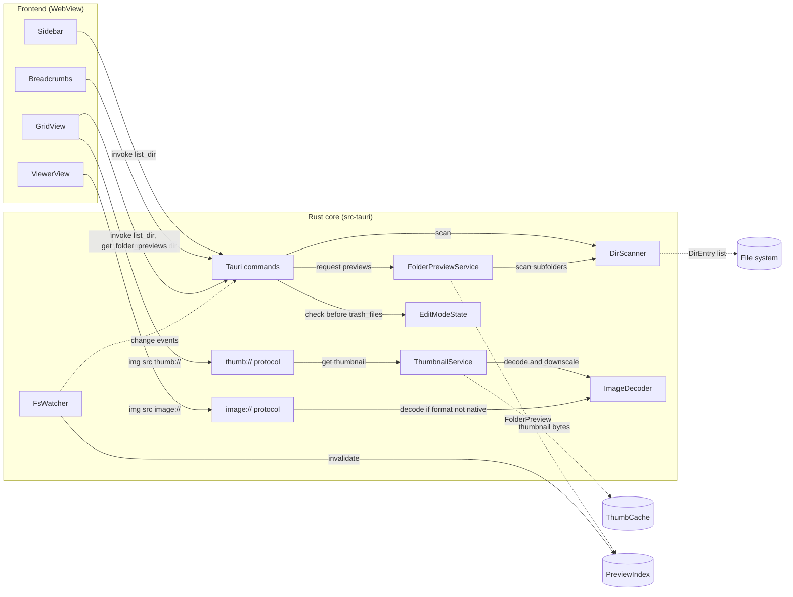
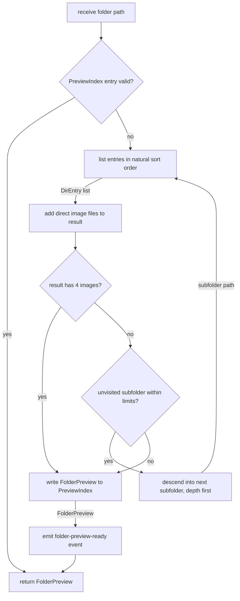
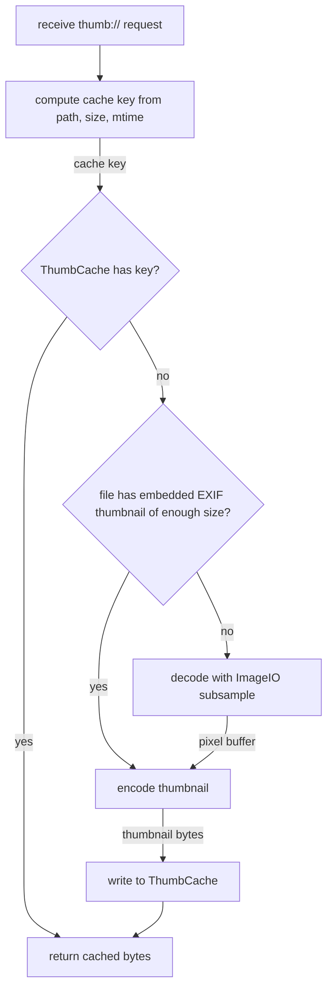
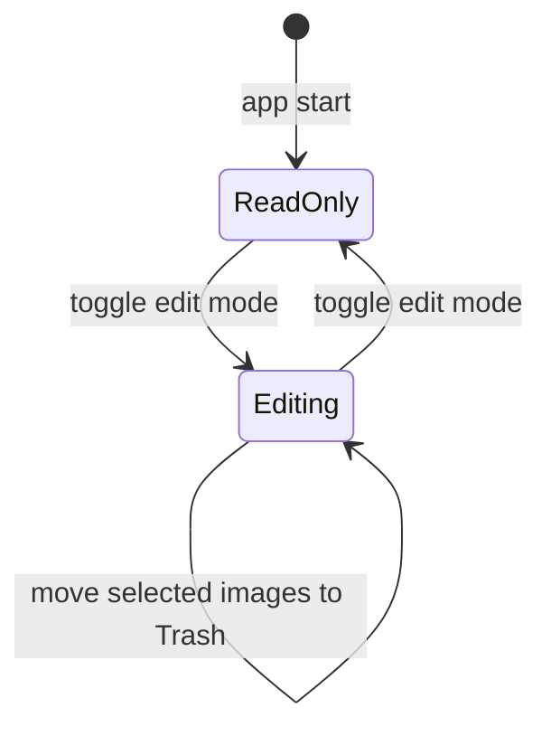

# Fast Gallery Requirements

## Summary

Fast Gallery is a macOS image browser built with Tauri 2 and Rust. It is similar to Pixea in look and speed.

The main feature is the folder preview. Each folder tile in the grid shows the first 4 images that the folder contains.

The app finds these images recursively, so the user does not need to open nested folders to see their content.

Example: the file `/gallery/2026/01/image1.jpg` exists, and the user opens `/gallery`. The tile of folder `2026` shows
`image1.jpg` and the next 3 images.

The app has 2 main views:

- **Grid view:** shows the folders and images of one directory as tiles.
- **Viewer:** shows one image at full size, with keyboard navigation to the previous and next image.

An edit mode controls file changes. While edit mode is on, the user can move images to the macOS Trash.

Each requirement has an ID and a checkbox. Mark the checkbox `- [x]` after the requirement is implemented and verified.

The keywords `MUST`, `MUST NOT`, `SHOULD`, and `MAY` have the meaning from RFC 2119.

## Project Priorities

Performance is the highest priority of the project.
The priorities apply in this order to each design and implementation decision.

| Rank | Priority          | Measured by                                      |
|------|-------------------|--------------------------------------------------|
| 1    | Performance       | PERF-02, PERF-05 to PERF-10                      |
| 2    | Small footprint   | PERF-01, PERF-03, PERF-04                        |
| 3    | Feature scope     | All other requirements                           |

- [ ] **PRIO-01** A change MUST NOT make a performance budget fail.
- [ ] **PRIO-02** A feature that conflicts with a performance budget MUST be optional, or it MUST
  move to Future Improvements.
- [x] **PRIO-03** The implementation MUST select the fastest option among options that meet all MUST requirements.
- [x] **PRIO-04** Each change to scan, decode, cache, or grid code MUST include a benchmark result or a profile.

## Technical Breakdown

### Structural Diagram

The frontend reads directory data through Tauri commands and reads image bytes through custom URI protocols.



### File Tree

```text
fast-gallery/
├── docs/                    # requirements, architecture, ADRs
├── src/                     # frontend: SolidJS, TypeScript, CSS (Vite)
│   ├── views/               # GridView, ViewerView (SolidJS components)
│   └── components/          # Sidebar, Breadcrumbs, Tile (SolidJS components)
└── src-tauri/
    ├── src/
    │   ├── commands/        # Tauri command handlers, EditModeState
    │   ├── protocols/       # thumb:// and image:// handlers
    │   ├── scan/            # DirScanner, FolderPreviewService
    │   ├── thumbs/          # ThumbnailService, ThumbCache
    │   ├── decode/          # ImageDecoder (ImageIO bindings)
    │   └── watch/           # FsWatcher (FSEvents)
    └── tauri.conf.json
```

### Behavioral Diagram: Folder Preview Resolution

`FolderPreviewService` resolves the 4 preview images of one folder with this process.



### Behavioral Diagram: Thumbnail Request

The `thumb://` protocol handler returns thumbnail bytes for one image path and one size.



## Technology Stack

| Component             | Choice                                         | Purpose                                        |
|-----------------------|------------------------------------------------|------------------------------------------------|
| App shell             | Tauri 2                                        | Native window, WebView, IPC, bundling          |
| Backend language      | Rust (stable)                                  | File system scan, decode, cache                |
| Frontend              | SolidJS, TypeScript, and Vite                  | Fine-grained reactivity, small bundle          |
| Image decode          | macOS ImageIO through the `objc2` crates       | Native HEIC, RAW, and subsampled JPEG decode   |
| Fallback decode       | `image` crate and `fast_image_resize` crate    | Decode and resize where ImageIO is unavailable |
| Preview index         | SQLite through the `rusqlite` crate            | Persistent `FolderPreview` storage             |
| File system events    | FSEvents through the `notify` crate            | Cache invalidation                             |
| Parallel work         | `rayon` thread pool                            | Thumbnail generation off the main thread       |

## Requirements

### Platform

- [ ] **PLAT-01** The app MUST run on macOS 12 Monterey and later.
- [x] **PLAT-02** The app MUST build as a universal binary for Apple Silicon and Intel.
- [x] **PLAT-03** The app MUST use the system WebView (WKWebView). It MUST NOT bundle a browser engine.
- [ ] **PLAT-04** The app SHOULD support the macOS light and dark appearance and follow the system setting.
- [x] **PLAT-05** The app SHOULD use native macOS window chrome with a transparent title bar.
- [ ] **PLAT-06** The app MAY register as an "Open With" handler for the supported image types.

### Performance and Size Budgets

The app MUST meet these budgets on an Apple M1 with 8 GB RAM and an SSD.

| ID       | Metric                                                         | Budget       |
|----------|----------------------------------------------------------------|--------------|
| PERF-01  | Size of the installed `.app` bundle                            | ≤ 15 MB      |
| PERF-02  | Cold start to an interactive window                            | ≤ 500 ms     |
| PERF-03  | Memory use at idle with an empty window                        | ≤ 80 MB      |
| PERF-04  | Memory use with a folder of 10,000 images open in grid view    | ≤ 300 MB     |
| PERF-05  | List a directory of 10,000 entries                             | ≤ 150 ms     |
| PERF-06  | First visible thumbnails from cache after folder open          | ≤ 100 ms     |
| PERF-07  | Time to generate one 256 px thumbnail from a 24 MP JPEG        | ≤ 30 ms      |
| PERF-08  | Grid scroll frame rate                                         | 60 fps       |
| PERF-09  | Viewer: show next image that is already prefetched             | ≤ 50 ms      |
| PERF-10  | Viewer: show next 24 MP JPEG that is not prefetched            | ≤ 200 ms     |

- [x] **PERF-01** The bundle size meets the budget.
- [x] **PERF-02** The cold start meets the budget.
- [ ] **PERF-03** The idle memory use meets the budget.
- [x] **PERF-04** The memory use with a large folder meets the budget.
- [x] **PERF-05** The directory listing meets the budget.
- [x] **PERF-06** The cached thumbnail display meets the budget.
- [x] **PERF-07** The thumbnail generation meets the budget.
- [x] **PERF-08** The grid scroll meets the budget.
- [x] **PERF-09** The prefetched image display meets the budget.
- [x] **PERF-10** The uncached image display meets the budget.
- [x] **PERF-11** The app MUST NOT block the UI thread with file system access or image decode.
- [x] **PERF-12** The app MUST cancel thumbnail jobs for tiles that leave the viewport before the job starts.
- [x] **PERF-13** The app MUST send image bytes through the `thumb://` and `image://` protocols. It MUST NOT send image
  bytes as base64 through IPC.
- [x] **PERF-14** The app MUST include a benchmark that measures PERF-05 and PERF-07.

### Supported Image Formats

| Format         | Extensions                          | Priority |
|----------------|-------------------------------------|----------|
| JPEG           | `.jpg`, `.jpeg`                     | MUST     |
| PNG            | `.png`                              | MUST     |
| HEIC and HEIF  | `.heic`, `.heif`                    | MUST     |
| WebP           | `.webp`                             | MUST     |
| GIF            | `.gif`                              | MUST     |
| TIFF           | `.tif`, `.tiff`                     | SHOULD   |
| BMP            | `.bmp`                              | SHOULD   |
| AVIF           | `.avif`                             | SHOULD   |
| Camera RAW     | `.cr2`, `.cr3`, `.nef`, `.arw`, `.dng`, `.raf`, `.orf` | MAY |
| SVG            | `.svg`                              | MAY      |

- [x] **FMT-01** The app MUST show thumbnails and full images for all MUST formats in the table.
- [x] **FMT-02** The app SHOULD support the SHOULD formats in the table.
- [ ] **FMT-03** The app MAY support the MAY formats in the table.
- [x] **FMT-04** The app MUST identify image files by extension, case-insensitive.
- [x] **FMT-05** The app MUST apply the EXIF orientation to thumbnails and full images.
- [ ] **FMT-06** The app SHOULD play animated GIF and WebP files in the viewer.
- [x] **FMT-07** The app MUST show a placeholder tile for a file that fails to decode.

### Folder Navigation

- [ ] **NAV-01** The user MUST be able to open a folder with the system folder picker (`⌘O`).
- [ ] **NAV-02** The user MUST be able to open a folder by drag and drop onto the window.
- [x] **NAV-03** The app MUST show a breadcrumb bar with each component of the current path.
- [x] **NAV-04** A click on a breadcrumb component MUST open that folder.
- [x] **NAV-05** The app MUST support back (`⌘[`) and forward (`⌘]`) navigation through the folder history.
- [x] **NAV-06** The app MUST open the parent folder with `⌘↑`.
- [x] **NAV-07** A double-click or `⌘↓` on a folder tile MUST open the folder.
- [x] **NAV-08** The app MUST show a sidebar with Favorites, Recent folders, and mounted volumes.
- [x] **NAV-09** The user MUST be able to add and remove a folder in Favorites.
- [x] **NAV-10** The sidebar MUST be collapsible (`⌘⌥S`).
- [x] **NAV-11** The app MUST restore the last open folder at start.
- [x] **NAV-12** The app SHOULD support several windows (`⌘N`), each with its own folder.

### Grid View

- [x] **GRID-01** The grid MUST show folders first, then images.
- [x] **GRID-02** The grid MUST hide files that are not supported images.
- [x] **GRID-03** The grid MUST hide hidden files and folders. The user MAY show them with `⌘⇧.`.
- [x] **GRID-04** The grid MUST render only the tiles in the viewport and a buffer of 2 rows (virtualization).
- [x] **GRID-05** Each image tile MUST show the thumbnail and the file name.
- [x] **GRID-06** The user MUST be able to change the tile size with a slider and with `⌘+` and `⌘-`.
- [x] **GRID-07** The tile size MUST be in the range 96 px to 512 px.
- [x] **GRID-08** The grid MUST show a tile placeholder of the final size before the thumbnail is ready.
- [x] **GRID-09** The grid MUST load thumbnails in viewport order, visible tiles first.
- [x] **GRID-10** The user MUST be able to sort by name, date modified, date taken, and file size.
- [x] **GRID-11** Sort by name MUST use natural order: `image2.jpg` comes before `image10.jpg`.
- [x] **GRID-12** The app MUST remember the sort order and tile size per folder.
- [x] **GRID-13** The user MUST be able to select tiles with click, `⌘`-click, `⇧`-click, and `⌘A`.
- [x] **GRID-14** The arrow keys MUST move the selection in the grid.
- [x] **GRID-15** `Return` or a double-click on an image tile MUST open the viewer.
- [x] **GRID-16** Typing letters MUST select the first tile whose name starts with those letters.
- [x] **GRID-17** The status bar MUST show the number of folders, the number of images, and the selection count.

### Folder Preview

- [x] **FPV-01** Each folder tile MUST show up to 4 preview images in a 2×2 layout on a folder shape.
- [x] **FPV-02** The preview images MUST be the first images in the current sort order of the grid.
- [x] **FPV-03** A change of the grid sort order MUST resolve the folder previews again.
- [x] **FPV-04** The `PreviewIndex` key MUST contain the folder path and the sort order.
- [x] **FPV-05** `FolderPreviewService` MUST take direct images of the folder first.
- [x] **FPV-06** `FolderPreviewService` MUST descend into subfolders, depth first, until it finds 4 images.
- [x] **FPV-07** The recursive search MUST stop at a depth of 6 levels below the folder.
- [x] **FPV-08** The recursive search MUST stop after it reads 2,000 directory entries for one folder.
- [x] **FPV-09** The recursive search MUST NOT follow symbolic links.
- [x] **FPV-10** The recursive search MUST skip hidden folders and macOS package folders, for example `.app` and
  `.photoslibrary`.
- [x] **FPV-11** A folder with 1 to 3 images MUST show only the images it has.
- [x] **FPV-12** A folder with no images MUST show an empty folder shape.
- [x] **FPV-13** The folder tile MUST show the folder name and the total image count of the direct children.
- [x] **FPV-14** `FolderPreviewService` MUST resolve previews in parallel, visible folder tiles first.
- [x] **FPV-15** `FolderPreviewService` MUST send each result to the frontend as a `folder-preview-ready` event.
- [x] **FPV-16** `FolderPreviewService` MUST store each `FolderPreview` in `PreviewIndex`.
- [x] **FPV-17** A `PreviewIndex` entry MUST become invalid after a change to a file or folder inside its tree.
- [x] **FPV-18** The app MUST show a cached `FolderPreview` at once and refresh it in the background.

### Thumbnails and Cache

- [x] **THM-01** `ThumbnailService` MUST generate thumbnails in 2 sizes: 256 px and 512 px on the long edge.
- [x] **THM-02** The grid MUST use the 512 px size for tiles larger than 256 px or on Retina displays.
- [x] **THM-03** `ThumbnailService` MUST use the embedded EXIF thumbnail of a JPEG or RAW file if it has the requested
  size.
- [ ] **THM-04** `ThumbnailService` MUST use ImageIO subsampled decode (`kCGImageSourceCreateThumbnailFromImageAlways`)
  for other files.
- [x] **THM-05** `ThumbnailService` MUST encode thumbnails as JPEG at quality 80, or as PNG for images with alpha.
- [x] **THM-06** `ThumbnailService` MUST encode thumbnails with ImageIO (`CGImageDestination`) for the fastest encode.
- [x] **THM-07** `ThumbCache` MUST store thumbnails in `~/Library/Caches/<bundle id>/thumbs`.
- [x] **THM-08** The cache key MUST contain the file path, the file size, the modification time, and the thumbnail size.
- [x] **THM-09** `ThumbCache` MUST limit its disk use to 2 GB by default and remove the least recently used entries.
- [x] **THM-10** The user MUST be able to change the cache limit and clear the cache in Settings.
- [x] **THM-11** `ThumbnailService` MUST keep a memory cache of the most recent 500 thumbnails.
- [x] **THM-12** The number of decode threads MUST NOT exceed the number of performance CPU cores.

### Viewer

- [x] **VIEW-01** The viewer MUST show one image, scaled to fit the window by default.
- [x] **VIEW-02** `→` and `Space` MUST show the next image. `←` and `⇧Space` MUST show the previous image.
- [x] **VIEW-03** `Home` and `End` MUST show the first and the last image of the folder.
- [x] **VIEW-04** The viewer MUST prefetch and decode the next 2 and the previous 1 image.
- [x] **VIEW-05** The viewer MUST show the cached thumbnail first and replace it with the full image after decode.
- [x] **VIEW-06** The user MUST be able to zoom with pinch, `⌘+`, `⌘-`, and the scroll wheel with `⌘`.
- [x] **VIEW-07** `⌘0` MUST fit the image to the window. `⌘1` MUST show the image at 100 %.
- [x] **VIEW-08** The user MUST be able to pan a zoomed image with drag and with the trackpad.
- [x] **VIEW-09** `Escape` MUST close the viewer and select the current image in the grid.
- [ ] **VIEW-10** `⌘⌃F` MUST toggle full screen.
- [x] **VIEW-11** The viewer MUST use the current sort order of the grid.
- [x] **VIEW-12** The viewer SHOULD show a film strip of thumbnails at the bottom. The user MAY hide it.
- [x] **VIEW-13** The viewer SHOULD start a slideshow with an interval the user selects.
- [x] **VIEW-14** The viewer SHOULD rotate the image view by 90° with `⌘R` and `⌘L`, without a change to the file.
- [x] **VIEW-15** The viewer MUST show the image name, the position in the folder, and the zoom level.

### Image Information

- [x] **INFO-01** `⌘I` MUST toggle an information panel.
- [x] **INFO-02** The panel MUST show file name, path, size, dimensions, format, and modification date.
- [x] **INFO-03** The panel SHOULD show EXIF data: camera, lens, focal length, aperture, shutter, ISO, and date taken.
- [ ] **INFO-04** The panel MAY show the GPS location as coordinates.

### Edit Mode

Edit mode controls all actions that change files. The app starts with edit mode off.



- [x] **EDIT-01** `⌘E` and a toolbar button MUST toggle edit mode on and off.
- [x] **EDIT-02** Edit mode MUST be off at each app start.
- [x] **EDIT-03** The window MUST show a visible indicator while edit mode is on.
- [x] **EDIT-04** `EditModeState` in the Rust core MUST hold the edit mode state for each window.
- [x] **EDIT-05** The `trash_files` command MUST reject the request if edit mode is off.
- [x] **EDIT-06** The frontend MUST hide or disable each action that changes files while edit mode is off.
- [x] **EDIT-07** The app MUST NOT move, rename, or delete files while edit mode is off.

### File Operations That Change Files

These actions are available only while edit mode is on.

- [x] **FILE-01** `⌘⌫` MUST move the selected images to the macOS Trash.
- [x] **FILE-02** Each image tile and the viewer toolbar MUST show a Move to Trash button.
- [x] **FILE-03** The app MUST use the macOS Trash API (`NSFileManager.trashItem`), so Finder "Put Back" works.
- [x] **FILE-04** The app MUST NOT show a confirmation dialog for a move to Trash.
- [x] **FILE-05** The app MUST support undo (`⌘Z`) of the last move to Trash.
- [x] **FILE-06** After a move to Trash in the viewer, the viewer MUST show the next image.
- [x] **FILE-07** After a move to Trash in the grid, the selection MUST move to the next tile.
- [x] **FILE-08** The app MUST show an error message for a file that it cannot move to Trash.

### File Operations That Do Not Change Files

These actions are available in both modes.

- [ ] **FILE-09** `⌘C` MUST copy the selected files to the clipboard as file references.
- [ ] **FILE-10** The user MUST be able to drag tiles out of the app to Finder and to other apps.
- [ ] **FILE-11** A drag out of the app MUST copy the files. It MUST NOT move them.
- [ ] **FILE-12** `⌘⇧R` MUST reveal the selected file in Finder.
- [ ] **FILE-13** The user SHOULD be able to open the selected file in another app from the context menu.
- [ ] **FILE-14** The user SHOULD be able to set an image as the desktop picture.

### File System Changes

- [x] **FSW-01** `FsWatcher` MUST watch the open folder for changes.
- [x] **FSW-02** The grid MUST add, remove, and rename tiles within 1 second of a file system change.
- [x] **FSW-03** A change to a file MUST invalidate its `ThumbCache` entries.
- [x] **FSW-04** A change inside a folder tree MUST invalidate the `PreviewIndex` entries of the folder and its parents.
- [x] **FSW-05** The app MUST keep the scroll position and the selection after a file system change.

### Settings

- [ ] **SET-01** `⌘,` MUST open the Settings window.
- [x] **SET-02** Settings MUST contain: default sort order, default tile size, show hidden files, and cache limit.
- [x] **SET-03** Settings MUST contain the folder preview depth limit, in the range 1 to 10.
- [x] **SET-04** The app MUST store settings in the Tauri app config directory.

### Privacy and Security

- [x] **SEC-01** The app MUST NOT send data over the network.
- [x] **SEC-02** The Tauri capability configuration MUST allow only the commands and protocols the app uses.
- [x] **SEC-03** The `thumb://` and `image://` handlers MUST return only files with a supported image extension.
- [x] **SEC-04** The app MUST show a clear message for a folder the user has no permission to read.
- [x] **SEC-05** The app MUST request Full Disk Access only if the user opens a protected folder.

### Accessibility

- [x] **A11Y-01** Every action MUST have a keyboard shortcut or a keyboard path.
- [x] **A11Y-02** Tiles MUST have accessible names for VoiceOver.
- [ ] **A11Y-03** The app SHOULD respect the macOS "Reduce motion" setting.

## Limitations

- The app is a browser and viewer. It does not edit image pixels.
- The folder preview search has limits on depth and on entry count (FPV-07, FPV-08). A folder with images only below
  these limits shows an empty folder shape.

## Future Improvements

- Distribution (Phase 2): a signed and notarized `.dmg` file.
- Distribution (Phase 2): a Mac App Store release with App Sandbox and security-scoped bookmarks.
- Quick Look extension that shows the folder preview in Finder.
- Search by file name inside the open folder tree.
- Compare view for 2 to 4 selected images.
- Basic edits: crop, rotate, and save, available only in edit mode.
- Rename of files and folders, available only in edit mode.
- Ratings and tags stored in XMP sidecar files.
