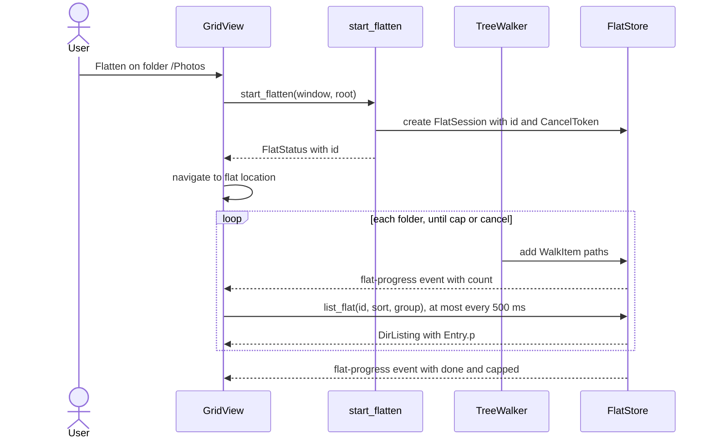
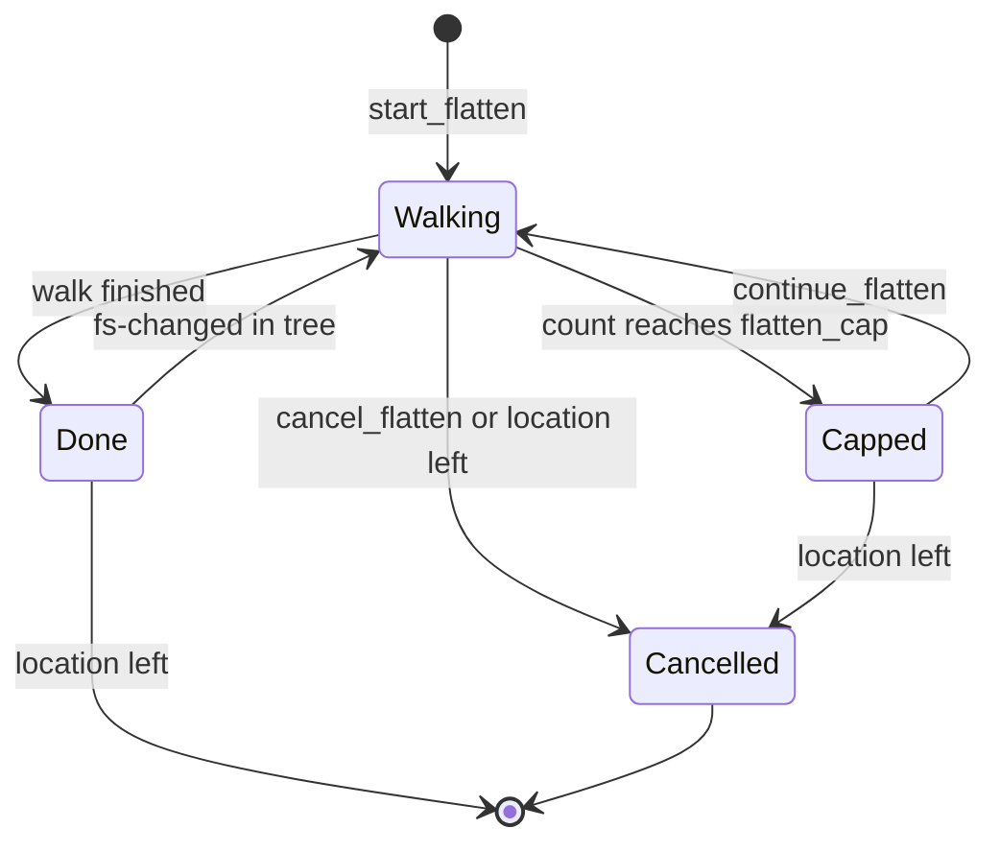

# Flatten and Ignored Folders

## Summary

The user selects "Flatten" in the context menu of a folder. The window then shows the photos of the folder tree in one grid.

The app streams the photos during the walk, so the first photos show at once. The user can stop the walk at any time.

A cap, a one-volume rule, and ignored folders limit the cost of a flatten of a broad root.

"Ignored folders" is a new setting with defaults for the macOS system trees. The app never lists, previews, scans, or
flattens a folder in this list.

Main design decision: a flatten is a per-window listing that is separate from `TaskRunner` (D1). The cost is controlled
by streaming, a cap, and cancel (D2), not by a block of broad roots.

> Context: this story uses the structure of the spec-writing story template. Earlier stories in `docs/story/` use a
> free checklist form; this story adds `Context and Gap`, `Design Decisions`, and `Verification` for the implementing
> agent.

## Prior Art

| App                | Feature                                     | Model                                        |
|--------------------|---------------------------------------------|----------------------------------------------|
| Adobe Bridge       | View → Show Items from Subfolders           | Toggle on the current folder, streamed       |
| ACDSee             | Flatten Folder Hierarchy                    | View mode of the current folder              |
| digiKam            | View → Include Album Sub-Tree               | Toggle, reads from its database              |
| XnView MP          | Show files in subfolders (recursive browse) | Toggle with a recursion option               |
| Lightroom Classic  | Folders panel → Show Photos in Subfolders   | Toggle, catalog only, so no disk walk        |
| Finder, Explorer   | Search `kind:image` in the folder           | System index, instant, can be stale          |

> Assumption: the menu names are from memory of these apps, not checked against current versions. They only justify
> the model "a view of a folder, streamed, cancellable". No app in the table blocks a flatten of a broad root.

## Context and Gap

| Existing                                                  | State today                                                                                         | Change                                                                       |
|-----------------------------------------------------------|-----------------------------------------------------------------------------------------------------|------------------------------------------------------------------------------|
| `TreeWalker` (`src-tauri/src/pipeline/walk.rs`)           | Depth-first walk with `max_depth`, `max_images`, and `CancelToken`. Skips links, hidden, packages.  | Add the one-volume rule (D5). Resume after the cap (FLAT-09).                |
| `read_entries` (`src-tauri/src/scan/mod.rs`)              | One place that lists a folder for the grid, the previews, and the walker. Skips hidden and packages. | Skip ignored folders (IGN-03).                                               |
| `PACKAGE_EXTS`, `is_hidden_name` (`scan/mod.rs`)          | Fixed rules for FPV-09 and FPV-10.                                                                  | No change. Ignored folders are a separate, user-editable rule.               |
| `Settings` (`src-tauri/src/commands/settings.rs`)         | Has `scan_cap`, `recents`, `favorites`, and no ignore list.                                          | Add `ignored_folders` and `flatten_cap`.                                     |
| `SettingsView.tsx` (`src/views/`)                         | Settings form.                                                                                      | Add the "Ignored folders" editor and the flatten cap.                        |
| `Location`, `LocationProvider` (`src/lib/locations.ts`)   | Two kinds: `disk` and `collection`. `CollectionProvider` shows `[name]` after the root crumbs.        | Add the kind `flat` and `FlatProvider`.                                      |
| `list_collection` (`src-tauri/src/commands/collections.rs`) | Builds a `DirListing` from absolute paths with `Entry.p` and `arrange::list_paths`.               | `list_flat` uses the same functions.                                         |
| `actions.ts` (`src/lib/`)                                 | Defines each context-menu action once (QUAL-06), for example "Scan for Bad Photos".                 | Add "Flatten", "Show in Folder", and "Ignore Folder".                       |
| `FsWatcher` (`src-tauri/src/watch/mod.rs`)                | FSEvents watch of the open folder; reports changed child folder trees.                              | A `flat` location is watched at its root and listed again after a change.    |

## Design Decisions

### D1: A flatten is a per-window listing, not a `TaskRunner` task

- **Decision:** `start_flatten` runs a `TreeWalker` on the scan pool with a `CancelToken` that the window owns. It does not
  use `TaskRunner`.
- **Reason:** `TaskRunner` runs 1 task for the whole app and locks file changes in its tree (QUAL-01 to QUAL-03). A
  flatten only reads. It must not block a bad photo scan, and a scan must not block it. Two windows can flatten two
  different folders at the same time.
- **Rejected:** a `TaskKind::Flatten` in `TaskRunner` - it reuses the progress UI, but it blocks file operations and
  every other task for no reason.
- **Revisit if:** a flatten gets a write side effect, for example cached analysis.

### D2: The cost is controlled by streaming, a cap, and cancel, not by a block of broad roots

- **Decision:** a flatten is allowed on every folder except `/` and ignored folders. The walk streams results, stops at
  `flatten_cap`, and stops when the user cancels or leaves the location.
- **Reason:** the user pays for the walk only while they look at it. A flatten of a volume root is the most useful case:
  a camera card has `DCIM/100CANON`, `DCIM/101CANON`, and more. A rule that blocks volume roots or the home folder blocks
  real use.
- **Rejected:** a confirmation dialog for broad roots - it is friction on the common case and does not limit the cost.
  A fixed depth limit - photo archives are often deep (`Year/Month/Event`).

### D3: `/` is the only root that cannot be flattened

- **Decision:** "Flatten" is disabled on `/`.
- **Reason:** after the default ignored folders, `/` contains only `/Users` and `/Volumes`. A flatten of
  `/` is a flatten of `/Users` plus every volume, which is never a useful view. The menu item gives the tooltip
  "Flatten a folder inside the disk".

### D4: The app sorts the full flat listing on each refresh; the frontend does not merge batches

- **Decision:** the backend keeps the paths found so far. The `flat-progress` event tells the window to call `list_flat`,
  at most every 500 ms. `list_flat` returns a sorted and grouped `DirListing`, like `list_collection`.
- **Reason:** this fits `LocationProvider.list` with no new grid code. The sort, the groups, and FSW-05 (keep scroll and
  selection) work as for any other refresh.
- **Rejected:** append each batch in the frontend - the sort order then breaks, or the frontend needs its own sort.
- **Risk:** a refresh of 20,000 entries every 500 ms costs CPU. If PERF-08 fails during a walk, raise the interval to
  1 s, or send only the count while the user scrolls.

### D5: The walk stays on the volume of the root

- **Decision:** the walker does not enter a folder whose device ID (`st_dev`) differs from the device ID of its parent.
- **Reason:** a flatten of a folder must not enter another disk or a network share mounted inside it, which can be slow
  or hang.
- **Rejected:** follow mount points - a flatten of a folder can then walk a whole network share.

> Context: APFS firmlinks do not break this rule. `stat -f '%d %N' / /Users /Applications` printed the same device ID
> (16777232) for all three paths on the development Mac (macOS 27.2). `/System/Volumes/Data` has its own ID, but it is
> an ignored folder.

### D6: An ignored folder and its whole tree are blocked, also for an explicit open

- **Decision:** an ignored folder never shows as a folder tile, in a folder preview, in a walk, or in a flatten. An
  open of an ignored folder, or of a folder inside one, shows no tiles. The grid center shows the message "This folder
  is ignored" and the button "Open Settings". This applies to path edit, "Open Folder", drag and drop, Recents,
  Favorites, and the last folder at start.
- **Reason:** user decision. "Ignored" means that the app never shows the content, so the rule has no exception.
- **Rejected:** list the folder with a banner after an explicit open - it keeps iCloud Drive in `~/Library` reachable,
  but the user wants one strict rule.

> Context: iCloud Drive and Messages attachments are inside `~/Library`. The defaults ignore only 6 large subfolders of
> `~/Library`, so D6 does not block them.

### D7: Ignored folders are exact paths, not name patterns

- **Decision:** each entry is an absolute path, or a path that starts with `~/`. The rule skips that folder and, as a
  result, its whole tree.
- **Reason:** the system trees have fixed paths. A name pattern such as `Library` also hides a user folder with that name
  in a photo archive.
- **Rejected:** glob patterns - more power than the defaults need, and a wrong pattern hides photos without a clear cause.
- **Revisit if:** the user asks to ignore a name in every location, for example `@eaDir` folders of a Synology NAS.

## Default Ignored Folders

`Settings::default()` contains this list. "Restore Defaults" in Settings writes it again.

| Path                            | Content                                           |
|---------------------------------|---------------------------------------------------|
| `/System`                       | Sealed system volume, also `/System/Volumes/Data` |
| `/Library`                      | System-wide support files, caches, and fonts      |
| `/private`                      | Target of `/etc`, `/tmp`, and `/var`              |
| `/etc`                          | Link to `/private/etc`                            |
| `/tmp`                          | Link to `/private/tmp`                            |
| `/var`                          | Link to `/private/var`                            |
| `/usr`                          | Unix tools and libraries, also Homebrew on Intel  |
| `/bin`                          | Unix tools                                        |
| `/sbin`                         | Unix tools                                        |
| `/opt`                          | Homebrew on Apple silicon                         |
| `/cores`                        | Crash core dumps                                  |
| `/dev`                          | Device files                                      |
| `/Network`                      | Automount point for network servers               |
| `/home`                         | Automount point                                   |
| `/Applications`                 | App bundles                                       |
| `~/Library/Caches`              | Per-user app caches                               |
| `~/Library/Containers`          | Sandboxed app data                                |
| `~/Library/Group Containers`    | Shared sandboxed app data                         |
| `~/Library/Application Support` | Per-user app data                                 |
| `~/Library/Developer`           | Xcode data and simulators                         |
| `~/Library/Logs`                | Log files                                         |

> Rationale: `/etc`, `/tmp`, and `/var` are symbolic links. The walker skips links (FPV-09), but the grid follows them, so
> they show as folder tiles in `/` without an entry. `/Network` and `/home` are automount points: a read can wait for a
> network timeout. The `~/Library` subfolders hold most of the per-user app files, and the images in them are app
> caches, not user photos.

> Rationale: the list ignores 6 subfolders of `~/Library`, not `~/Library` itself (user decision). iCloud Drive
> (`~/Library/Mobile Documents`) and Messages attachments (`~/Library/Messages/Attachments`) stay reachable. The cost is
> a `Library` folder tile in the home folder.

> Assumption: `/Volumes` is not in the list because external disks and camera cards are there. `/Volumes/Macintosh HD` is
> a link to `/`, which the walker skips (FPV-09).


## Technical Breakdown

### Behavioral Diagram: Flatten of a Folder



### Behavioral Diagram: Flatten Session Lifecycle



### Backend API

| Command / event       | Input                       | Output                                                      |
|-----------------------|-----------------------------|-------------------------------------------------------------|
| `start_flatten`       | `root: String`              | `FlatStatus { id, root, count, done, capped, cancelled }`  |
| `list_flat`           | `id, sort, group`           | `DirListing` with `Entry.p` set, key `flat:<root>`         |
| `continue_flatten`    | `id`                        | `FlatStatus`; raises the limit by `flatten_cap`             |
| `cancel_flatten`      | `id`                        | `FlatStatus`                                                |
| `flat-progress` event | -                           | `FlatStatus`, sent to the window that owns the session     |

- `FlatStore` lives in `AppState`. It holds at most 1 session for each window label.
- A new `start_flatten` from a window cancels and removes the previous session of that window.
- `lib.rs` cancels the sessions of a window when the window closes, as it does for tasks (`cancel_for_window`).

### Frontend API

```typescript
type FlatLocation = { kind: "flat"; path: string }; // a flattened disk folder; key "flat:<path>"

interface FlatStatus {
    id: string; // session id from start_flatten
    root: string; // absolute path of the flattened folder
    count: number; // photos found so far
    done: boolean; // the walk finished the whole tree
    capped: boolean; // the walk stopped at the cap and the tree has more photos
    cancelled: boolean; // the user or a location change stopped the walk
}
```

`FlatProvider` values:

| Member      | Value                                                                                   |
|-------------|-----------------------------------------------------------------------------------------|
| `title`     | `<folder name> (Flattened)`                                                              |
| `crumbs`    | Disk crumbs of `path`, then `[Flattened]`                                               |
| `caps`      | `recents: true`, `folderPrefs: true`, `watch: true`, all other caps `false`             |
| `parent`    | The disk location `path`                                                                |
| `emptyText` | "No photos in this folder or its subfolders" when done, else "Looking for photos…"     |

> Rationale: `favorites: false` because a favorite is a disk path in the sidebar. `scan: false` because "Scan for Bad
> Photos" on the disk folder already covers the same tree.

## Requirements

### Flatten

- [x] **FLAT-01** The context menus of 1 selected folder tile and of a disk folder background MUST have "Flatten".
- [x] **FLAT-02** "Flatten" MUST be disabled on `/` and on an ignored folder or a folder inside one (D3, D6).
- [x] **FLAT-03** "Flatten" MUST open the `flat` location in the same window.
- [x] **FLAT-04** The walk MUST use the rules FPV-09, FPV-10, IGN-03, and D5.
- [x] **FLAT-05** If the tree has photos, the grid MUST show the first photos within 500 ms of the walk start.
- [x] **FLAT-06** The status bar MUST show "Flattening… N photos" and a Cancel button while the walk runs.
- [x] **FLAT-07** The walk MUST stop when the window leaves the `flat` location or closes.
- [x] **FLAT-08** The walk MUST stop at `flatten_cap` photos. Settings MUST contain `flatten_cap`: minimum 1,000, default
  20,000, maximum 100,000.
- [x] **FLAT-09** At the cap, the grid MUST show the banner "Showing the first N photos" with "Show More". "Show More"
  MUST continue the walk for `flatten_cap` more photos.
- [x] **FLAT-10** A `flat` location MUST support the viewer, the info panel, sort, group, selection, and FILE-01 to
  FILE-14, as QUAL-22.
- [x] **FLAT-11** The info panel and the tile tooltip MUST show the folder of the photo, relative to the flattened root.
- [x] **FLAT-12** The context menu of a photo in a `flat` location MUST have "Show in Folder". It opens the disk folder
  of the photo and selects the photo.
- [x] **FLAT-13** The group menu MUST have "Folder" in a `flat` location. It groups photos by their relative folder.
- [x] **FLAT-14** A file system change inside the root MUST start a new walk. The grid MUST keep scroll and
  selection (FSW-05).
- [x] **FLAT-16** A `flat` location MUST sort by date modified, newest first, until the user changes the sort. The
  changed sort MUST be stored per location (`folderPrefs`).
- [x] **FLAT-15** Recents MUST store a `flat` location as `flat:<path>` and show it as "<name> (Flattened)".

> Rationale: FLAT-11 and FLAT-13 exist because file names repeat in a flattened tree: a camera writes `IMG_0001.JPG` in
> each `DCIM/1xxCANON` folder.

### Ignored Folders

- [x] **IGN-01** Settings MUST contain the "Ignored folders" list with "Add Folder…", "Remove", and "Restore Defaults".
- [x] **IGN-02** `Settings.ignored_folders` MUST store each path as entered. A path that starts with `~/` MUST resolve to
  the home folder when settings load.
- [x] **IGN-03** `read_entries` MUST skip a folder entry whose path is in the ignored set. This applies to the grid,
  `FolderPreviewService`, `TreeWalker`, the bad photo scan, and a flatten.
- [x] **IGN-04** The ignored set MUST compare paths without case and without a trailing `/`.
- [x] **IGN-05** An open of a folder in an ignored tree MUST show no tiles (D6). The grid center MUST show "This
  folder is ignored" and "Open Settings".
- [x] **IGN-06** A change of the list MUST refresh the open windows and invalidate the `PreviewIndex` entries.
- [x] **IGN-07** `Settings::default()` MUST contain the paths of `## Default Ignored Folders`.
- [x] **IGN-08** The folder tile context menu MUST have "Ignore Folder". It adds the folder to the list.
- [x] **IGN-09** "Open Settings" in the ignored message MUST open Settings at the "Ignored folders" list.
- [x] **IGN-10** `list_dir` MUST return the error `ignored` for a folder in an ignored tree. The frontend MUST show the
  IGN-05 message for this error.

> Rationale: IGN-10 puts the rule in the backend, so every way to open a folder gets the same result. A check only in
> the frontend misses a path from Recents or from the last folder at start.

> Rationale: IGN-04 because the default APFS volume is case-insensitive: `/library` and `/Library` are the same folder.

> Rationale: IGN-06 because the image count of a folder preview (FPV-13) includes the images of ignored subfolders
> until the entry is resolved again.

> Context: `Settings` has `#[serde(rename_all = "camelCase", default)]`, so a settings file without `ignoredFolders`
> loads the default list and keeps the other fields.

## Out of Scope

- Spotlight (`mdfind -onlyin`) as a fast source of the file list. External and FAT disks are often not indexed, so the
  walker stays the source of truth.
- Ignore rules by name or glob pattern (D7).
- Windows and Linux default lists. The app targets macOS.

## Limitations

- The date-taken order in a `flat` location reads the EXIF date of each photo that is not in `PreviewIndex`. The first
  listing of a large tree in this order is slow.
- The walk does not enter other volumes (D5). A folder that is a mount point inside the tree is not flattened.
- An ignored folder still uses the FSEvents watch of its parent. Events inside it are ignored only after classification.

## Clarifications

- **Ignored folder open (D6):** user decision. An ignored tree shows no tiles, also after an explicit open.
- **Default sort in a `flat` location (FLAT-16):** user decision. Date modified, newest first.
- **`~/Library` in the defaults:** user decision. The defaults ignore 6 large subfolders, not `~/Library` itself.

## Verification

| Check          | Command               |
|----------------|-----------------------|
| Typecheck      | `npm run typecheck`   |
| Frontend test  | `npm test`            |
| Backend test   | `npm run test:rust`   |
| Build          | `npm run build:all`   |
| Start          | `npm start`           |

## Tasks

**Phase 1: Ignored folders**

- [x] Ensure the project compiles and the existing tests pass
- [x] Add `ignored_folders: Vec<String>` with the defaults to `Settings`, with `#[serde(default)]` (IGN-02, IGN-07)
- [x] Add an `IgnoreSet` (resolved, lowercase paths) to `AppState`, rebuilt on `update_settings` (IGN-04)
- [x] Pass the `IgnoreSet` through `ListOptions` and skip ignored folders in `read_entries` (IGN-03)
- [x] Invalidate `PreviewIndex` and send a refresh to all windows after a change (IGN-06)
- [x] Add the "Ignored folders" editor to `SettingsView.tsx`, with `pick_folder` for "Add Folder…" (IGN-01)
- [x] Return the error `ignored` from `list_dir` for a folder in an ignored tree (IGN-10)
- [x] Show the "This folder is ignored" message with "Open Settings" in the grid center (IGN-05, IGN-09, D6)
- [x] Add "Ignore Folder" to `actions.ts` (IGN-08)
- [x] Add tests for the code of this phase

Acceptance criteria:

- [x] `npm run test:rust` passes, including `read_entries_skips_ignored_folders`, `ignore_set_matches_without_case`, and
  `old_settings_file_gets_default_ignored_folders`
- [x] `npm run test:rust` passes, including `list_dir_returns_ignored_inside_ignored_tree`
- [x] `npm test` passes, including a test of the ignored message for the `ignored` error
- [x] Manual: open `/` in the app. `System`, `Library`, `private`, `usr`, `etc`, `tmp`, and `var` do not show
- [ ] Manual: open `~/Library/Caches` by path edit. The grid shows only the ignored message, and "Open Settings"
  opens the list

**Phase 2: Flatten backend**

- [x] Add the one-volume rule to `TreeWalker` as `WalkOptions.same_volume` (D5)
- [x] Add a resume of the walk after the cap, so `continue_flatten` does not walk the tree again (FLAT-09)
- [x] Add `FlatStore` and the commands `start_flatten`, `list_flat`, `continue_flatten`, `cancel_flatten` (D1, D4)
- [x] Send `flat-progress` at most every 500 ms (D4)
- [x] Cancel the sessions of a window on close in `lib.rs` (FLAT-07)
- [x] Add `flatten_cap` to `Settings` with the clamp 1,000 to 100,000 (FLAT-08)
- [x] Register the new commands in the capability files (SEC-02)
- [x] Add tests for the code of this phase

Acceptance criteria:

- [x] `npm run test:rust` passes, including `walk_stays_on_volume`, `flatten_stops_at_cap_and_continues`,
  `flatten_cancel_stops_walk`, and `list_flat_sets_entry_path`

**Phase 3: Flatten frontend**

- [x] Add `FlatLocation`, `FlatProvider`, and the `flat:` key to `locations.ts` (FLAT-03, FLAT-15)
- [x] Add the "Flatten" action with the D3 and D6 rules, and the "Show in Folder" action (FLAT-01, FLAT-02, FLAT-12)
- [x] Show the progress and Cancel in `StatusBar.tsx`, and the cap banner in the grid (FLAT-06, FLAT-09)
- [x] Show the relative folder in `InfoPanel.tsx` and the tile tooltip (FLAT-11)
- [x] Add the "Folder" group key for `flat` locations (FLAT-13)
- [x] Use date modified, newest first, as the default order in a `flat` location (FLAT-16)
- [x] Start a new walk on `fs-changed` for a `flat` location (FLAT-14)
- [x] Add tests for the code of this phase

Acceptance criteria:

- [x] `npm test` passes, including `parseLocation` round trip for `flat:` and the disabled state of "Flatten" on `/`
- [x] Manual: flatten `examples/example gallery`. The grid shows all 18 photos with their relative folders
- [x] Manual: flatten the home folder. The first photos show in less than 500 ms, and Cancel stops the walk
- [ ] Manual: PERF-08 (60 fps scroll) passes while a flatten of the home folder runs

> Context: the manual checks ran with the `FG_DEV_SCRIPT` hook of a debug build on 2026-11-18. The flatten of the home
> folder showed the first photos after 52 ms. `/` listed only `pkg`, `Users`, and `Volumes`. `~/Library/Caches`
> returned the error `ignored`; the click on "Open Settings" and PERF-08 still need a check by hand.

**Phase X:**

- [x] Add FLAT-01 to FLAT-16 and IGN-01 to IGN-10 to `docs/requirements/requirements.md`
- [x] Move D1, D2, D5, and D6 to `docs/architecture-adr.md`
- [x] Review the implementation against this story and the project conventions

Acceptance criteria:

- [x] Every command in `## Verification` passes
- [x] The application starts with `npm start`
